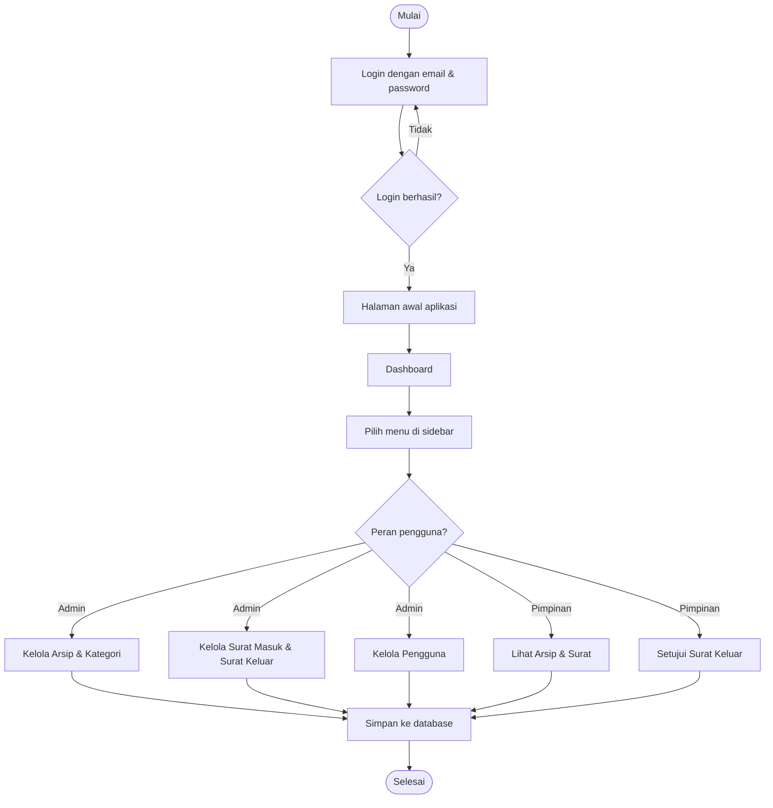
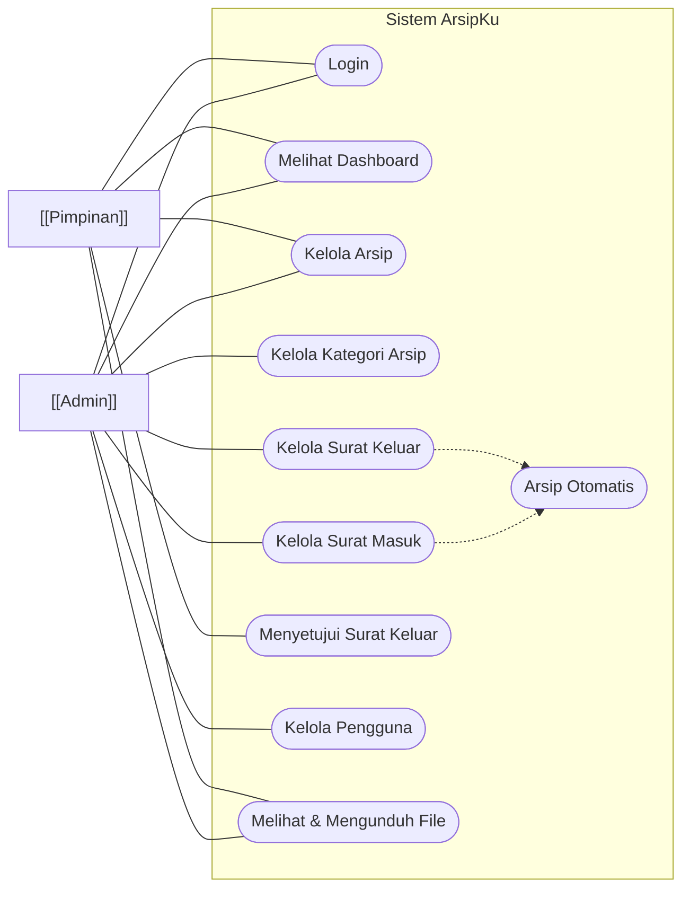
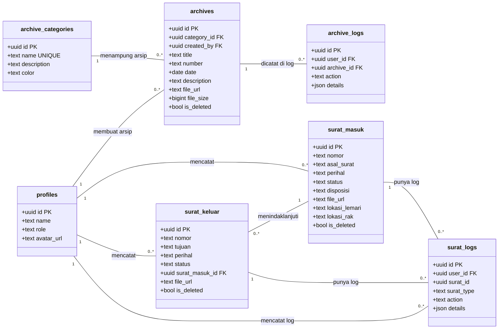
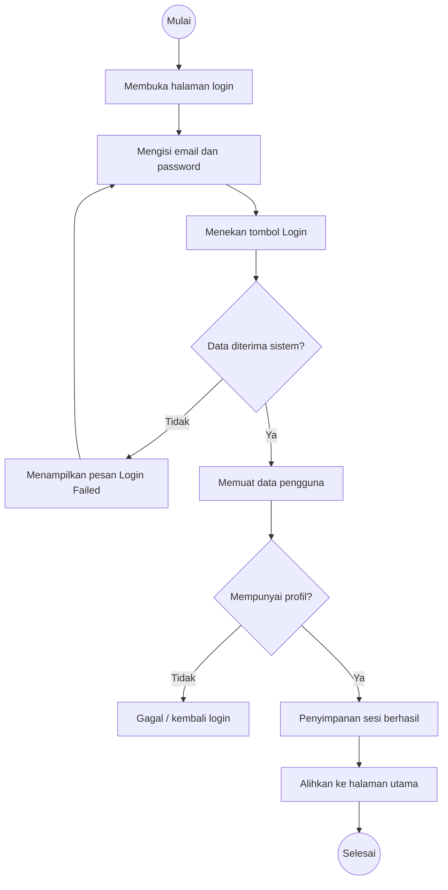
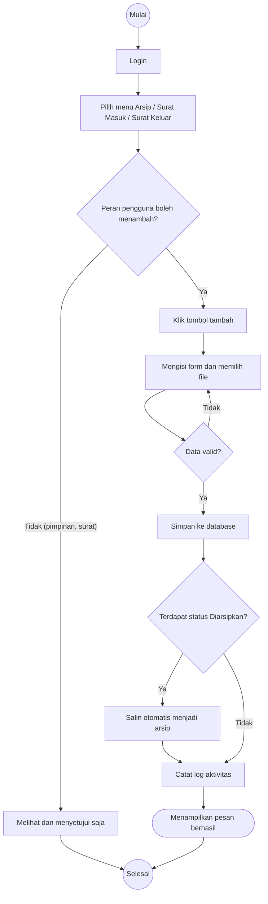
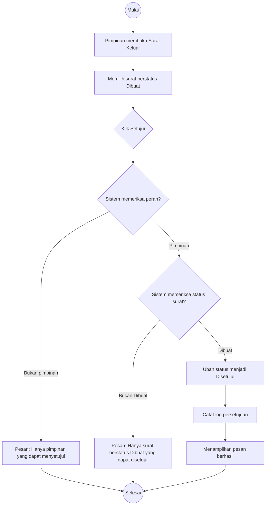
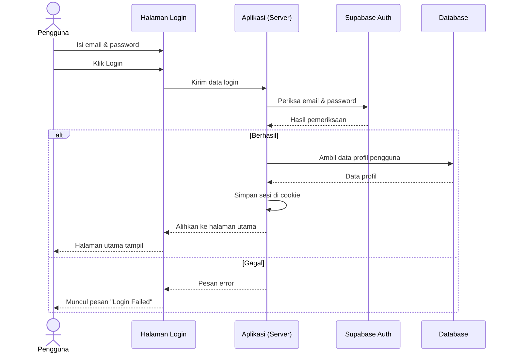
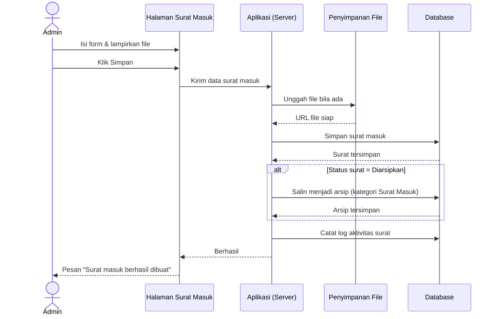
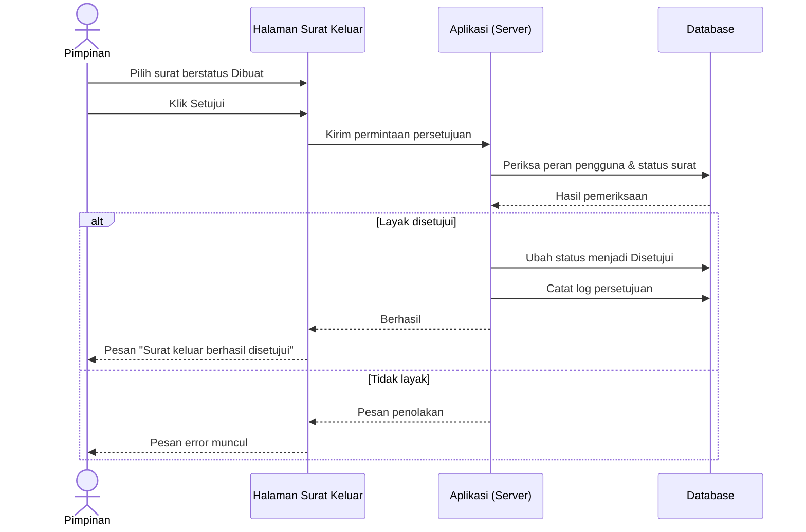
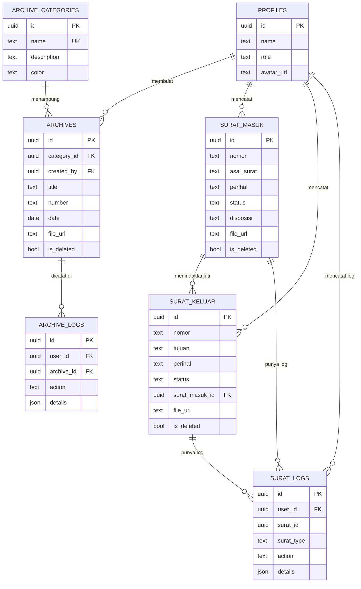

# Dokumentasi Aplikasi

> **Aplikasi:** ArsipKu — Sistem Manajemen Arsip & Surat Digital
> **Instansi:** Dinas Pemuda dan Olahraga (Dispora) Kota Medan
> **Versi dokumentasi:** 1.0
> **Tanggal pembuatan:** 23 September 2026

---

## 1. Gambaran Umum

### 1.1 Nama Aplikasi

Aplikasi ini bernama **ArsipKu — Sistem Manajemen Arsip & Surat Digital**. Aplikasi dikembangkan sebagai aplikasi web (dibuka melalui peramban/browser) dan berjalan di perangkat yang terhubung internet.

### 1.2 Tujuan Aplikasi

ArsipKu dibuat untuk membantu kantor **Dinas Pemuda dan Olahraga (Dispora) Kota Medan** mengelola surat dan arsip secara digital. Tujuan utama aplikasi ini adalah:

1. Mencatat surat masuk dan surat keluar dalam satu tempat.
2. Menyimpan arsip dokumen (file digital) dan lokasi arsip fisik (lemari, rak, map, box).
3. Memudahkan pencarian surat dan arsip tanpa harus membongkar berkas kertas.
4. Menjaga kerapian data dengan mencatat siapa yang menambah, mengubah, atau menghapus data (jejak aktivitas/log).
5. Mempercepat alur persetujuan surat keluar oleh pimpinan.

### 1.3 Masalah yang Ingin Diselesaikan

- Surat dan arsip tercatat di banyak tempat (buku agenda, kertas, folder), sehingga sulit dicari kembali.
- Kesulitan mengetahui di mana lokasi fisik suatu berkas arsip berada.
- Tidak ada catatan siapa yang mengubah atau menghapus data, sehingga sulit ditelusuri bila terjadi kesalahan.
- Proses persetujuan surat keluar harus dikonfirmasi langsung kepada pimpinan, memakan waktu.
- Arsip kertas yang rusak atau hilang sulit dipulihkan.

### 1.4 Siapa Pengguna Aplikasi

| Pengguna | Penjelasan |
| -------- | ---------- |
| **Admin** | Petugas atau staf yang mengelola data: user, kategori, arsip, surat masuk, dan surat keluar. |
| **Pimpinan** | Kepala dinas / bidang yang melihat arsip dan surat serta memberikan persetujuan surat keluar. |

### 1.5 Gambaran Singkat Cara Kerja Aplikasi

1. Pegawai membuka aplikasi melalui peramban dan **login** menggunakan alamat email dan kata sandi.
2. Setelah masuk, pegawai tiba di **halaman awal** lalu mengklik tombol **Masuk Dashboard** untuk melihat ringkasan data.
3. Melalui **menu di samping kiri**, pegawai memilih bagian yang ingin dikerjakan: Arsip, Kategori, Surat Masuk, Surat Keluar, atau (khusus admin) Pengguna.
4. Pegawai dapat menambah, melihat, mengubah, atau menghapus data. Setiap aktivitas penting **tercatat otomatis** oleh sistem.
5. Data disimpan di **database** (gudang data) yang terhubung ke aplikasi. File dokumen disimpan sebagai **lampiran digital** dan bisa diunduh kembali.
6. Kepala dinas (pimpinan) dapat melihat seluruh surat dan arsip serta **menyetujui surat keluar** yang berstatus "Dibuat".
7. Surat yang berstatus "Diarsipkan" otomatis masuk ke daftar arsip tanpa harus diinput dua kali.

---

## 2. Role dan Hak Akses Pengguna

Aplikasi ini memiliki **dua role** pengguna: **Admin** dan **Pimpinan**. Role menentukan menu yang terlihat dan tindakan yang diizinkan.

| Role | Penjelasan | Hak Akses |
| ---- | ---------- | --------- |
| **Admin** | Pengelola/petugas (contoh: staf tata usaha, sekretaris). Orang yang bekerja sehari-hari menginput dan merapikan data. | - Melihat dashboard admin (ringkasan data surat, arsip, pengguna). - Mengelola **Pengguna** (menambah, mengubah, menghapus). - Mengelola **Kategori arsip**. - Menambah, melihat, mengubah, menghapus, dan memulihkan **Arsip**. - Menambah, melihat, mengubah, dan menghapus **Surat Masuk** serta **Surat Keluar** (termasuk mengubah status). - Mengunduh file dokumen arsip/surat. - **Tidak dapat** menyetujui surat keluar. |
| **Pimpinan** | Kepala dinas/kepala bidang yang bertugas menyetujui surat keluar dan memantau arsip. | - Melihat dashboard pimpinan (statistik surat/arsip dan daftar surat menunggu persetujuan). - Melihat dan **mengunduh** arsip. - Menambah, mengubah, dan menghapus **Arsip**. - Melihat surat masuk dan surat keluar. - **Menyetujui Surat Keluar** yang berstatus "Dibuat". - **Tidak dapat** mengelola Pengguna dan Kategori arsip. - **Tidak dapat** menambah/mengubah/menghapus surat masuk maupun surat keluar. - **Khusus:** di tab **Sampah**, pimpinan tetap dapat **memulihkan** surat yang telah dihapus. |

> Catatan penting:
> - Ketika halaman aplikasi tidak menemukan role pengguna dengan jelas, sistem menganggap pengguna tersebut sebagai **Admin**.
> - Pimpinan yang mencoba membuka halaman Pengguna atau Kategori arsip otomatis **dialihkan ke Dashboard**.
> - Hak akses di atas berdasarkan kode aplikasi. Pengamanan di tingkat database (row level security) membatasi pengguna yang belum login agar tidak dapat mengakses data.

---

## 3. Daftar Fitur

### 3.1 Fitur untuk Semua Pengguna (Login)

| No | Fitur | Fungsi | Pengguna |
| -- | ----- | ------ | -------- |
| 1 | Login | Masuk ke aplikasi menggunakan email dan kata sandi | Admin, Pimpinan |
| 2 | Logout | Keluar dari aplikasi dengan aman | Admin, Pimpinan |
| 3 | Navigasi sidebar | Berpindah halaman melalui menu di sisi kiri | Admin, Pimpinan |
| 4 | Mode terang/gelap | Mengubah tampilan aplikasi menjadi terang atau gelap | Admin, Pimpinan |

### 3.2 Fitur Arsip (Dokumen)

| No | Fitur | Fungsi | Pengguna |
| -- | ----- | ------ | -------- |
| 5 | Menambah arsip | Mencatat arsip baru beserta file dokumen | Admin, Pimpinan |
| 6 | Melihat daftar & detail arsip | Melihat daftar arsip dan rincian arsip (termasuk file, kategori, pengunggah) | Admin, Pimpinan |
| 7 | Mengubah arsip | Memperbaiki data arsip yang sudah ada | Admin, Pimpinan |
| 8 | Menghapus & memulihkan arsip | Menghapus (masuk ke Sampah) dan memulihkan arsip dari Sampah | Admin, Pimpinan |
| 9 | Mengunduh file arsip | Menyimpan file dokumen arsip ke perangkat | Admin, Pimpinan |
| 10 | Kelola kategori arsip | Menambah, mengubah, menghapus kategori (mis. Undangan, Laporan) | Admin |

### 3.3 Fitur Surat

| No | Fitur | Fungsi | Pengguna |
| -- | ----- | ------ | -------- |
| 11 | Menambah surat masuk | Mencatat surat yang diterima (asal, perihal, status, disposisi, file) | Admin |
| 12 | Mengubah surat masuk | Memperbaiki data surat masuk | Admin |
| 13 | Menghapus & memulihkan surat masuk | Menghapus dan memulihkan surat masuk | Admin; Pimpinan memulihkan di tab Sampah |
| 14 | Menambah / mengubah surat keluar | Mencatat surat yang dikirim, termasuk mengaitkan surat masuk terkait | Admin |
| 15 | Persetujuan surat keluar | Menyetujui surat keluar berstatus "Dibuat" menjadi "Disetujui" | Pimpinan |
| 16 | Menghapus & memulihkan surat keluar | Menghapus dan memulihkan surat keluar | Admin; Pimpinan memulihkan di tab Sampah |
| 17 | Arsip otomatis | Surat berstatus "Diarsipkan" otomatis dicatat sebagai arsip | Sistem (otomatis) |

### 3.4 Fitur Pengguna (Khusus Admin)

| No | Fitur | Fungsi | Pengguna |
| -- | ----- | ------ | -------- |
| 18 | Menambah pengguna | Membuat akun pengguna baru (nama, email, role, foto, kata sandi) | Admin |
| 19 | Mengubah pengguna | Mengubah nama, role, dan foto pengguna | Admin |
| 20 | Menghapus pengguna | Menghapus akun pengguna | Admin |

### 3.5 Fitur Pendukung

| No | Fitur | Fungsi | Pengguna |
| -- | ----- | ------ | -------- |
| 21 | Pencarian data | Mencari arsip/surat/kategori/pengguna dengan mengetik kata kunci | Admin, Pimpinan |
| 22 | Penyaring (filter) | Menyaring surat berdasarkan status atau arsip berdasarkan kategori | Admin, Pimpinan |
| 23 | Pembagian halaman (pagination) | Menampilkan data per halaman (10/25/50/100 baris) | Admin, Pimpinan |
| 24 | Jejak aktivitas | Menampilkan riwayat siapa yang menambah/mengubah/menghapus arsip | Admin, Pimpinan |

> Fitur yang **tidak tersedia** di aplikasi (tidak ditemukan di source code): mencetak laporan (print), mengunduh laporan PDF/Excel, melihat pratinjau PDF di dalam aplikasi, mengimpor data massal, menyaring berdasarkan rentang tanggal, dan mengurutkan kolom secara manual.

---

## 4. Panduan Penggunaan Aplikasi

### 4.1 Login

**Fungsi:** Memasuki aplikasi dengan akun yang telah didaftarkan.

**Cara menggunakan:**
1. Buka aplikasi melalui peramban.
2. Pada halaman **Welcome**, isi **Email** dengan alamat email akun.
3. Isi **Password** dengan kata sandi.
4. Klik tombol **Login**.
5. Jika berhasil, aplikasi membawa Anda ke halaman utama, lalu Anda bisa mengklik tombol **Masuk Dashboard**.

**Contoh penggunaan:** Email: `petugas.surat@arsipku.test`, Password: `Petugas123!` (akun contoh dari data percobaan).

**Hasil:** Anda masuk ke aplikasi dan dapat mengakses menu sesuai role.

**Catatan:**
- Email wajib diisi dengan format yang benar.
- Password wajib diisi (tidak ada syarat panjang khusus).
- Jika salah, muncul pesan "Login Failed" beserta keterangan dari sistem.
- Tidak ada fitur "lupa kata sandi" pada halaman login.

---

### 4.2 Logout

**Fungsi:** Keluar dari aplikasi dengan aman.

**Cara menggunakan:**
1. Di bagian bawah menu samping kiri, arahkan kursor ke gambar profil Anda.
2. Klik menu **Keluar**.
3. Anda akan kembali ke halaman login.

**Hasil:** Sesi Anda ditutup. Untuk masuk kembali, lakukan login seperti biasa.

---

### 4.3 Navigasi Menu

**Fungsi:** Berpindah antar halaman aplikasi.

**Cara menggunakan:**
- Gunakan menu di sisi kiri (sidebar). Menu yang tersedia:

| Menu | Halaman | Admin | Pimpinan |
| ---- | ------- | ----- | -------- |
| Dashboard | Halaman utama / ringkasan data | ✔ | ✘ (akses lewat tombol "Masuk Dashboard" di halaman awal) |
| User | Pengelolaan akun pengguna | ✔ | ✘ |
| Surat Masuk | Pencatatan surat masuk | ✔ | ✔ (hanya lihat) |
| Surat Keluar | Pencatatan surat keluar | ✔ | ✔ (lihat + setujui) |
| Arsip | Daftar arsip | ✔ | ✔ |
| &nbsp;&nbsp;└ Semua Arsip | Sub-menu Admin: daftar seluruh arsip | ✔ | — |
| &nbsp;&nbsp;└ Kategori | Sub-menu Admin: kelola kategori arsip | ✔ | ✘ |

**Catatan:** Menu **Dashboard**, **User**, dan **Kategori** hanya tampil di sidebar untuk **Admin**. Pimpinan tetap dapat membuka halaman Dashboard melalui tombol **Masuk Dashboard** pada halaman awal.

**Hasil:** Anda berpindah ke halaman yang dipilih.

---

### 4.4 Dashboard

**Fungsi:** Melihat ringkasan data terbaru dalam satu halaman.

**Untuk Admin:**
- Sapaan "Selamat datang kembali, {nama}" dan jumlah dokumen arsip.
- Kartu statistik: **Surat Masuk**, **Surat Keluar**, **Total Arsip**, **User**.
- **Surat Masuk/Keluar Terbaru** (5 terbaru), **Arsip Terbaru**, **Aktivitas Terbaru**, diagram **Arsip per Kategori**, dan **Ringkasan**.

**Untuk Pimpinan:**
- Sapaan pengguna, pencarian arsip, **Arsip Terbaru**, kartu statistik (Surat Masuk, Surat Keluar, Total Arsip).
- Daftar **Menunggu Persetujuan** (surat keluar berstatus "Dibuat").

**Cara menggunakan:** klik judul menu pada tombol "Lihat Semua" untuk berpindah ke halaman lengkap.

---

### 4.5 Menambah Arsip

**Fungsi:** Mencatat arsip baru (judul, nomor, kategori, tanggal, deskripsi, dan file).

**Cara menggunakan:**
1. Buka menu **Arsip → Semua Arsip**.
2. Klik tombol **+ Arsip Baru**.
3. Isi form:
   - **Judul** (wajib): nama dokumen arsip.
   - **Nomor Dokumen** (boleh kosong): contoh `001/ABC/2026`.
   - **Kategori** (wajib): pilih kategori yang tersedia.
   - **Tanggal** (boleh kosong).
   - **Deskripsi** (boleh kosong).
   - **File Dokumen** (boleh kosong): file PDF atau gambar (JPG/PNG), keterangan "Maksimal 10MB".
4. Klik **Simpan**.

**Contoh penggunaan:** Judul "Undangan Rapat Dispora", Kategori "Undangan", Tanggal 5 Juli 2026, lampiran file `undangan.pdf`.

**Hasil:** Arsip tersimpan, tercatat di daftar arsip, muncul pesan "Arsip berhasil dibuat", dan aktivitas tersebut dicatat sistem.

**Catatan:**
- File yang dapat dipilih lewat form dibatasi jenis PDF/JPG/PNG. Keterangan "Maksimal 10MB" hanya berupa teks panduan; pembatas keras ukuran file ada pada pengaturan server (±10MB). **Validasi ukuran/tipe file di sisi server tidak ditemukan di source code (Belum dapat dipastikan dari source code).**

---

### 4.6 Melihat Arsip (Daftar & Detail)

**Fungsi:** Melihat daftar arsip dan rincian lengkap arsip.

**Cara menggunakan:**
1. Buka menu **Arsip → Semua Arsip**.
2. Gunakan kotak pencarian untuk mencari berdasarkan **judul atau nomor dokumen**.
3. Gunakan penyaring **Kategori** untuk mempersempit tampilan.
4. Klik ikon menu (⋮) pada baris arsip, lalu pilih **Detail**.
5. Panel rincian menampilkan: judul, nomor, kategori, tanggal, deskripsi, file dokumen, pengunggah, waktu pembuatan/pembaruan, dan **aktivitas** arsip.

**Hasil:** Anda melihat seluruh informasi arsip. Jika ada file gambar, file ditampilkan langsung; jika PDF, muncul kartu file. Klik **Download** untuk menyimpan file.

---

### 4.7 Mengubah Arsip

**Fungsi:** Memperbaiki data arsip yang keliru.

**Cara menggunakan:**
1. Buka **Arsip → Semua Arsip**, cari arsip yang ingin diubah.
2. Klik ikon menu (⋮), lalu pilih **Edit**.
3. Ubah isian tersebut. Saat update, file lama tetap dipertahankan jika tidak diganti ("File saat ini").
4. Klik **Perbarui**.

**Hasil:** Data arsip berubah dan pesan "Arsip berhasil diperbarui" muncul. Aktivitas perubahan tercatat.

---

### 4.8 Menghapus dan Memulihkan Arsip

**Fungsi:** Membuang arsip ke Sampah dan mengembalikannya jika diperlukan.

**Cara menggunakan:**
1. Buka **Arsip → Semua Arsip**.
2. Klik ikon menu (⋮) → **Hapus**, kemudian konfirmasi.
3. Data pindah ke tab **Sampah**. File dokumen disimpan sebagai Sampah digital turut dihapus dari penyimpanan.
4. Untuk memulihkan: buka tab **Sampah**, klik menu (⋮) → **Pulihkan**.

**Hasil:** Arsip hilang dari daftar aktif dan pesan "Arsip berhasil dihapus" muncul. Setelah dipulihkan, arsip kembali ke daftar aktif.

**Catatan:**
- Penghapusan bersifat "soft delete" (data tidak langsung hilang permanen). Namun **file dokumen yang terlanjur dihapus tidak ikut kembali saat dipulihkan**.

---

### 4.9 Menambah Kategori Arsip (Khusus Admin)

**Fungsi:** Membuat kelompok arsip baru (mis. "Laporan", "Surat Edaran", "Tugas").

**Cara menggunakan:**
1. Buka menu **Arsip → Kategori**.
2. Klik tombol **+ Kategori Baru**.
3. Isi:
   - **Nama Kategori** (wajib).
   - **Deskripsi** (boleh kosong).
   - **Warna** (boleh kosong) — pilih warna dengan alat pemilih warna.
4. Klik **Create**.

**Hasil:** Kategori tersimpan dan muncul di daftar (color chip).

**Catatan:**
- Nama kategori tidak boleh sama dengan kategori lain.
- Tombol simpan memakai kata "Create" dan "Update" (bahasa Inggris).
- Kategori yang dihapus **tidak bisa dipulihkan** (penghapusan permanen).

---

### 4.10 Menambah Surat Masuk (Admin)

**Fungsi:** Mencatat surat yang diterima kantor.

**Cara menggunakan:**
1. Buka menu **Surat Masuk**.
2. Klik tombol **+ Surat Masuk Baru**.
3. Isi bagian **Informasi Surat**:
   - **Nomor Surat** (wajib).
   - **Tanggal** (boleh kosong).
   - **Asal Surat** (boleh kosong).
   - **Perihal** (wajib).
   - **Status** (wajib): Diterima, Disposisi, Diproses, Selesai, Diarsipkan.
   - **Disposisi dari Pimpinan** (boleh kosong) — bisa memilih kalimat cepat seperti "Ke Bagian Umum", "Ke Sekretariat", "Untuk ditindaklanjuti", dan lain-lain.
   - **Keterangan** (boleh kosong).
   - **File Dokumen** (boleh kosong): PDF/JPG/PNG.
4. Isi bagian **Lokasi Arsip Fisik** (semua boleh kosong): **Lemari**, **Rak**, **Map**, **Box**, dan **Keterangan Fisik**.
5. Klik **Simpan**.

**Contoh penggunaan:** Nomor `001/Dispora/VI/2026`, Asal Surat "Kota Medan", Perihal "Undangan Rapat Evaluasi", Status "Diterima", Lemari "A", Rak "02".

**Hasil:** Surat masuk tercatat. Jika memilih status **Diarsipkan**, sistem otomatis menyalinnya menjadi arsip dengan kategori "Surat Masuk".

**Catatan:** Status default saat membuka form adalah **Diterima**. Disposisi dapat diisi teks bebas atau memilih kalimat siap pakai.

---

### 4.11 Menambah Surat Keluar (Admin)

**Fungsi:** Mencatat surat yang dikirim kantor.

**Cara menggunakan:**
1. Buka menu **Surat Keluar**.
2. Klik tombol **+ Surat Keluar Baru**.
3. Isi **Nomor Surat** (wajib), **Tanggal**, **Tujuan**, **Perihal** (wajib), **Status** (wajib — default "Dibuat").
4. Pilih **Surat Masuk Terkait** bila surat keluar ini merupakan jawaban/tindak lanjut dari surat masuk tertentu.
5. Isi **Keterangan**, **File Dokumen**, dan **Lokasi Arsip Fisik** (boleh kosong).
6. Klik **Simpan**.

**Hasil:** Surat keluar tercatat. Jika status **Diarsipkan**, otomatis disalin menjadi arsip dengan kategori "Surat Keluar".

---

### 4.12 Persetujuan Surat Keluar (Pimpinan)

**Fungsi:** Menyetujui surat keluar berstatus "Dibuat" agar menjadi "Disetujui".

**Cara menggunakan:**
1. Buka menu **Surat Keluar** (atau lihat daftar **Menunggu Persetujuan** di dashboard pimpinan).
2. Pada baris surat berstatus **Dibuat**, klik ikon menu (⋮) → **Setujui**.
3. Alternatif: buka **Detail** surat, lalu klik tombol **Setujui Surat Keluar**.
4. Konfirmasi.

**Hasil:** Status berubah menjadi **Disetujui**, dicatat siapa yang menyetujui beserta tanggal/waktunya (bagian "Disetujui oleh {nama}" muncul di detail).

**Catatan:**
- Hanya pimpinan yang dapat menyetujui.
- Hanya surat berstatus "Dibuat" yang dapat disetujui.
- Surat berstatus lain tidak menampilkan tombol Setujui.

---

### 4.13 Mengubah & Menghapus Surat (Admin)

**Fungsi:** Memperbaiki atau membuang data surat.

**Cara menggunakan:**
1. Buka menu **Surat Masuk** atau **Surat Keluar**.
2. Klik ikon menu (⋮) pada baris surat → pilih **Edit** (perbaiki data) atau **Hapus** (konfirmasi).
3. Untuk memulihkan: buka tab **Sampah** → **Pulihkan**.

**Hasil:** Perubahan tersimpan / data pindah ke Sampah, dan pesan sukses muncul.

**Catatan:** Pimpinan tidak melihat tombol Edit/Hapus dan tidak dapat menambah surat.

---

### 4.14 Mengelola Pengguna (Khusus Admin)

**Fungsi:** Membuat, mengubah, dan menghapus akun pengguna.

**Cara menggunakan (tambah user):**
1. Buka menu **User**.
2. Klik **+ User Baru**.
3. Isi (bahasa Inggris): **Name**, **Email**, **Avatar** (foto), **Role** (Admin/Pimpinan), **Password** — semua wajib.
4. Klik **Create User**.

**Mengubah user:** klik menu (⋮) → **Edit**. Nama, Role, dan Avatar dapat diubah; **Email dan password tidak dapat diubah**.
**Menghapus user:** klik menu (⋮) → **Delete**.

**Hasil:** Akun baru dapat login; perubahan tersimpan; akun yang dihapus tidak bisa login lagi.

**Catatan:** Foto avatar dan seluruh data user yang dihapus ikut hilang/terhapus dari penyimpanan.

---

### 4.15 Pencarian, Penyaring, dan Pembagian Halaman

**Fungsi:** Menemukan data dengan cepat.

**Cara menggunakan:**
- **Arsip:** ketik kata kunci di kotak "Cari judul atau nomor dokumen..."; pilih kategori untuk menyaring.
- **Surat Masuk/Keluar:** ketik kata kunci (nomor/perihal/asal atau tujuan); pilih **status** untuk menyaring.
- **Kategori:** ketik nama kategori.
- **User:** ketik nama pengguna.
- Gunakan bagian bawah tabel untuk memilih **baris per halaman** (10/25/50/100) dan halaman berikutnya/sebelumnya.

**Hasil:** Tabel menampilkan data yang cocok dengan kata kunci/pilihan.

---

### 4.16 Mengunduh File

**Fungsi:** Menyimpan file dokumen (gambar/PDF) pada arsip.

**Cara menggunakan:**
1. Buka **Detail** arsip atau surat.
2. Klik tombol **Download** pada bagian Dokumen.
3. File terbuka/terunduh dari server penyimpanan.

**Hasil:** File tersimpan di perangkat Anda.

---

### 4.17 Melihat Jejak Aktivitas

**Fungsi:** Mengetahui riwayat perubahan pada suatu arsip.

**Cara menggunakan:**
1. Buka **Detail** sebuah arsip.
2. Lihat bagian **Aktivitas**: sistem menampilkan "kategori aksi (dibuat/diperbarui/dihapus/dipulihkan) + nama pengguna + waktu".

**Hasil:** Anda mengetahui siapa dan kapan suatu arsip dibuat/diubah.

---

## 5. Alur Penggunaan Aplikasi (Flow Diagram)

Diagram berikut menunjukkan perjalanan pengguna, mulai dari membuka aplikasi hingga selesai menggunakan.

Penjelasan:
1. Pengguna login. Gagal → kembali mengisi form login.
2. Berhasil → masuk ke Dashboard.
3. Dari sidebar, pengguna memilih menu sesuai pekerjaannya.
4. Admin dapat mengelola arsip, kategori, surat, dan pengguna. Pimpinan dapat melihat arsip/surat dan menyetujui surat keluar.
5. Setiap data yang disimpan tercatat di database, lalu proses selesai.

---

## 6. Use Case Diagram

Diagram berikut menunjukkan siapa saja yang menggunakan aplikasi dan fitur apa saja yang dapat dilakukan.

Penjelasan aktor dan use case:

| Aktor / Use Case | Keterangan |
| ---------------- | ---------- |
| **Admin** | Pengelola data aplikasi: menambah/mengubah/menghapus arsip, kategori, surat, dan pengguna. |
| **Pimpinan** | Pemantau dan penyetuju: melihat arsip/surat dan menyetujui surat keluar. |
| Login | Semua pengguna harus login sebelum menggunakan aplikasi. |
| Melihat Dashboard | Kedua role melihat ringkasan data (tampilannya berbeda). |
| Kelola Arsip | Kedua role dapat menambah, melihat, mengubah, menghapus, dan memulihkan arsip. |
| Kelola Kategori Arsip | Hanya Admin (bagi Pimpinan, menu ini diblokir sistem). |
| Kelola Surat Masuk | Admin menambah/mengubah/menghapus; Pimpinan hanya melihat. |
| Kelola Surat Keluar | Admin menambah/mengubah/menghapus; Pimpinan hanya melihat + menyetujui. |
| Menyetujui Surat Keluar | Khusus Pimpinan, untuk surat berstatus "Dibuat". |
| Kelola Pengguna | Hanya Admin. |
| Melihat & Mengunduh File | Kedua role bisa di dalam detail arsip/surat. |
| Arsip Otomatis | Fitur sistem: surat berstatus "Diarsipkan" otomatis menjadi arsip. |

---

## 7. Class Diagram

Diagram ini menggambarkan data utama yang tersimpan di aplikasi dan hubungan antarnya. Strukturnya mengikuti tabel database yang benar-benar ada di aplikasi.

Penjelasan hubungan antar data:
- **profiles** adalah data pengguna (Admin/Pimpinan). Pengguna **menciptakan** arsip dan surat, dan **mencatat** log aktivitas.
- **archive_categories** adalah kelompok arsip. Satu kategori bisa menampung banyak arsip.
- **archives** adalah arsip. Satu arsip memiliki banyak catatan **archive_logs** (riwayat).
- **surat_masuk** dan **surat_keluar** adalah surat. Satu surat keluar dapat **berhubungan dengan satu surat masuk** (mis. balasan).
- **surat_logs** mencatat riwayat perubahan surat (termasuk persetujuan).

---

## 8. Activity Diagram

### 8.1 Activity Diagram — Login

### 8.2 Activity Diagram — Pengelolaan Arsip & Surat

### 8.3 Activity Diagram — Persetujuan Surat Keluar

---

## 9. Sequence Diagram

### 9.1 Sequence Diagram — Login

### 9.2 Sequence Diagram — Tambah Surat Masuk & Arsip Otomatis

### 9.3 Sequence Diagram — Persetujuan Surat Keluar

---

## 10. Struktur Data dan Database

Aplikasi menggunakan **Supabase** (PostgreSQL) sebagai database. Berikut tabel yang benar-benar ada:

### 10.1 Daftar Tabel

| Tabel | Fungsi |
| ----- | ------ |
| `profiles` | Data pengguna (nama, role, avatar). Dibuat otomatis saat akun dibuat. |
| `archive_categories` | Kategori arsip (mis. Undangan, Laporan, Dinas). |
| `archives` | Data arsip dokumen. |
| `archive_logs` | Riwayat aktivitas pada arsip (dibuat/diperbarui/dihapus/dipulihkan). |
| `surat_masuk` | Data surat masuk. |
| `surat_keluar` | Data surat keluar. |
| `surat_logs` | Riwayat aktivitas pada surat (mis. create, approve). |

### 10.2 Kolom Penting Setiap Tabel

| Tabel | Kolom penting | Keterangan |
| ----- | ------------- | ---------- |
| `profiles` | id (PK), name, role, avatar_url | id terhubung ke akun login (`auth.users`). role berisi `admin` atau `pimpinan`. |
| `archive_categories` | id (PK), name (unik), description, color | name unik → tidak boleh ada dua kategori dengan nama sama. |
| `archives` | id (PK), category_id (FK), created_by (FK), title, number, date, description, file_url/file_path/file_name/file_size, is_deleted, deleted_at | is_deleted menandai arsip dihapus (Sampah). |
| `archive_logs` | id (PK), user_id (FK), archive_id (FK), action, details, created_at | action contoh: create/update/delete/restore/auto_archive. |
| `surat_masuk` | id (PK), nomor, tanggal, asal_surat, perihal, status, disposisi, keterangan, file_*, lokasi_* (lemari/rak/map/box), keterangan_fisik, created_by (FK), is_deleted | status: diterima, disposisi, diproses, selesai, diarsipkan. |
| `surat_keluar` | id (PK), nomor, tanggal, tujuan, perihal, status, surat_masuk_id (FK), keterangan, file_*, lokasi_*, created_by (FK), is_deleted | status: dibuat, disetujui, dikirim, selesai, diarsipkan. |
| `surat_logs` | id (PK), user_id (FK), surat_id, surat_type, action, details, created_at | surat_type berisi `masuk` atau `keluar`. |

### 10.3 Relasi Antar Tabel

- `profiles.id` → `archives.created_by` (siapa membuat arsip).
- `archive_categories.id` → `archives.category_id` (arsip dikelompokkan ke kategori).
- `archives.id` → `archive_logs.archive_id` (log arsip).
- `profiles.id` → `surat_masuk.created_by` / `surat_keluar.created_by` (pencatat surat).
- `surat_masuk.id` → `surat_keluar.surat_masuk_id` (surat keluar menindaklanjuti surat masuk).
- `profiles.id` → `surat_logs.user_id` (siapa mencatat log surat).

### 10.4 Diagram ERD

Keterangan: `PK` = kunci utama (pengenal unik baris data), `FK` = kunci tamu (penghubung ke tabel lain), `UK` = harus unik.

---

## 11. Validasi dan Aturan Bisnis

### 11.1 Aturan Form

| Form | Wajib diisi | Boleh dikosongkan | Catatan |
| ---- | ----------- | ----------------- | ------- |
| Login | Email (format valid), Password | — | Tidak ada syarat panjang password. |
| Arsip | Judul, Kategori | Nomor, Tanggal, Deskripsi, File | File hanya lewat pemilih file (PDF/JPG/PNG). |
| Kategori | Nama (unik) | Deskripsi, Warna | Nama tidak boleh sama. |
| Surat Masuk | Nomor, Perihal, Status | Tanggal, Asal, Disposisi, Keterangan, File, Lokasi Fisik | Status default: Diterima. |
| Surat Keluar | Nomor, Perihal, Status | Tanggal, Tujuan, Keterangan, File, Surat Masuk Terkait, Lokasi Fisik | Status default: Dibuat. |
| User | Name, Email (format valid), Avatar, Role, Password | — | Role hanya: Admin atau Pimpinan. Saat ubah user, email & password tidak bisa diubah. |

Pesan validasi yang muncul (contoh):
- "Judul arsip wajib diisi", "Kategori wajib dipilih".
- "Nama kategori wajib diisi".
- "Nomor surat wajib diisi", "Perihal wajib diisi".
- "Email is required", "Please enter a valid email", "Password is required" (form user).

### 11.2 Status yang Tersedia

| Data | Status |
| ---- | ------ |
| Surat Masuk | `diterima` (Diterima), `disposisi` (Disposisi), `diproses` (Diproses), `selesai` (Selesai), `diarsipkan` (Diarsipkan) |
| Surat Keluar | `dibuat` (Dibuat), `disetujui` (Disetujui), `dikirim` (Dikirim), `selesai` (Selesai), `diarsipkan` (Diarsipkan) |
| Arsip | Aktif / Sampah (dihapus) |

### 11.3 Aturan Bisnis Utama

1. **Persetujuan surat keluar** hanya dapat dilakukan oleh role **Pimpinan**, dan hanya untuk surat berstatus **Dibuat**. Jika bukan pimpinan muncul pesan "Hanya pimpinan yang dapat menyetujui surat keluar"; jika status bukan Dibuat muncul "Hanya surat berstatus Dibuat yang dapat disetujui".
2. **Arsip otomatis**: saat surat masuk/keluar disimpan dengan status **Diarsipkan**, sistem otomatis membuat arsip dengan kategori "Surat Masuk" (warna biru dongker) atau "Surat Keluar" (warna oranye). Kategori tersebut dibuat otomatis bila belum ada. Sistem mencegah data terduplikat memakai catatan log `auto_archive`.
3. **Penghapusan lunak (soft delete)** untuk arsip dan surat: data dihapus tidak langsung hilang permanen, tetapi pindah ke "Sampah" (`is_deleted = true`) dan dapat **dipulihkan**. Kategori arsip justru **dihapus permanen** dan tidak bisa dipulihkan.
4. **File dokumen**: ketika arsip/surat yang memiliki file dihapus, file di penyimpanan ikut dihapus. Saat dipulihkan, file tidak kembali.
5. **Hak akses halaman** (diterapkan oleh sistem): halaman **User** dan **Kategori** hanya untuk Admin; Pimpinan yang membukanya dialihkan ke Dashboard. Semua halaman selain login mengharuskan login.
6. Sistem tidak menghitung data "Sampah" pada select database; data sampah hanya tampil lewat tab Sampah.
7. **Batasan upload**: batas ukuran body server ±10MB. Validasi tipe file hanya di komponen form (accept PDF/JPG/PNG); **pemeriksaan tipe/ukuran di sisi server belum ditemukan di source code (Belum dapat dipastikan dari source code)**.

---

## 12. Kondisi Error dan Pesan Sistem

Berikut kondisi yang dapat terjadi dan respons sistem sesuai kode aplikasi.

| Kondisi | Respons Sistem |
| ------- | -------------- |
| Email/password login salah | Toast "Login Failed" dengan keterangan dari sistem (contoh: "Invalid login credentials"). |
| Email kosong / format salah | Validasi: "Email is required" / "Please enter a valid email". |
| Password kosong | Validasi: "Password is required". |
| Gagal membuat arsip | Toast "Gagal membuat arsip" + keterangan. |
| Berhasil membuat arsip | Toast "Arsip berhasil dibuat". |
| Gagal memperbarui arsip | Toast "Gagal memperbarui arsip". |
| Berhasil memperbarui arsip | Toast "Arsip berhasil diperbarui". |
| Gagal menghapus arsip | Toast "Gagal menghapus arsip". |
| Berhasil menghapus arsip | Toast "Arsip berhasil dihapus". |
| Berhasil memulihkan arsip | Toast "Arsip berhasil dipulihkan". |
| Gagal memuat data arsip | Teks "Gagal memuat data arsip". |
| Gagal memuat aktivitas arsip | Teks "Gagal memuat aktivitas arsip." |
| Gagal membuat surat masuk | Toast "Gagal membuat surat masuk" + keterangan. |
| Berhasil membuat surat masuk | Toast "Surat masuk berhasil dibuat". |
| Berhasil memperbarui surat masuk | Toast "Surat masuk berhasil diperbarui". |
| Berhasil menghapus surat masuk | Toast "Surat masuk berhasil dihapus". |
| Berhasil memulihkan surat masuk | Toast "Surat masuk berhasil dipulihkan". |
| Gagal membuat surat keluar | Toast "Gagal membuat surat keluar". |
| Berhasil membuat surat keluar | Toast "Surat keluar berhasil dibuat". |
| Berhasil disetujui (surat keluar) | Toast "Surat keluar berhasil disetujui". |
| Gagal menyetujui surat keluar | Toast "Gagal menyetujui surat keluar" + keterangan. |
| Bukan pimpinan mencoba menyetujui | Pesan "Hanya pimpinan yang dapat menyetujui surat keluar". |
| Surat keluar tidak berstatus Dibuat | Pesan "Hanya surat berstatus Dibuat yang dapat disetujui". |
| Gagal membuat kategori | Toast "Gagal membuat kategori". |
| Berhasil membuat kategori | Toast "Kategori berhasil dibuat". |
| Gagal membuat user | Toast "Create User Failed". |
| Berhasil membuat user | Toast "Create User Success". |
| Berhasil mengubah user | Toast "Update User Success". |
| Berhasil menghapus user | Toast "Delete User Success". |
| Data kosong pada tabel | Tampilan "tidak ada data" (empty state). |

> Catatan: bagian "keterangan" dari toast umumnya berisi pesan asli dari Supabase (mis. kendala jaringan atau aturan keamanan database). Format bahasa campuran Inggris/Indonesia mengikuti kode aplikasi.

---

## 13. Ringkasan Alur Sistem

**Penjelasan non-teknis:**

1. **Pengguna** membuka aplikasi lalu **login** dengan email dan kata sandi.
2. Aplikasi memeriksa akun tersebut. Bila cocok, pengguna masuk dan sesi disimpan, sehingga tidak perlu login ulang selama sesi aktif.
3. Pengguna **memilih menu** dan **mengisi data** (surat/arsip) lewat formulir, termasuk melampirkan file bila perlu.
4. Aplikasi **memproses** data: memeriksa kelengkapan, menyimpan ke database, mencatat siapa yang mengerjakan, dan menyimpan file ke penyimpanan cloud.
5. Untuk surat keluar berstatus "Dibuat", **pimpinan** dapat **menyetujui** melalui aplikasi; status berubah menjadi "Disetujui" dan tercatat.
6. Surat berstatus "Diarsipkan" otomatis menjadi **arsip**, sehingga data tidak perlu di-input ulang.
7. Terakhir, pengguna dapat **melihat kembali** data kapan saja melalui daftar, pencarian, dan detail — termasuk **mengunduh file** yang tersimpan.

**Penjelasan teknis singkat:** Aplikasi dibangun dengan **Next.js (React)** sebagai antarmuka dan **Supabase** sebagai database serta layanan autentikasi dan penyimpanan file. Autentikasi memakai akun Supabase yang disimpan dalam cookie sesi. Pengambilan data berjalan di peramban melalui perpustakaan React Query, sedangkan penyimpanan/perubahan data memakai "server action" yang memeriksa ulang aturan dan menulis ke database. Halaman dilindungi lapisan perantara (middleware) sehingga pengguna yang belum login dialihkan ke halaman login.

---

## 14. FAQ untuk Pengguna Awam

### Bagaimana cara masuk ke aplikasi?
Buka halaman login, isi **Email** dan **Password** akun Anda, lalu klik **Login**. Akun dibuat oleh Admin. Contoh akun percobaan: `petugas.surat@arsipku.test` / `Petugas123!`.

### Bagaimana cara menambahkan data?
Pilih menu (mis. **Arsip** atau **Surat Masuk**), klik tombol **+ (tambah)** di kanan atas, isi form (kolom bertanda wajib tidak boleh dikosongkan), lalu klik **Simpan**.

### Apa yang terjadi jika data salah?
Data dapat diperbaiki kapan saja. Buka baris data tersebut, klik ikon menu (⋮) → **Edit**, perbaiki, lalu **Perbarui**. Riwayat perubahannya tercatat otomatis.

### Siapa yang dapat mengubah data?
**Arsip** dapat diubah oleh Admin maupun Pimpinan. **Surat masuk/keluar** hanya dapat diubah oleh **Admin** (Pimpinan hanya melihat). **Data pengguna dan kategori** hanya oleh **Admin**. Khusus di tab **Sampah**, Pimpinan tetap dapat **memulihkan** surat yang sudah dihapus.

### Saya tidak menemukan data yang saya cari. Bagaimana?
Gunakan kotak pencarian di bagian atas tabel (misal cari berdasarkan nomor, judul, perihal, atau asal/tujuan surat), lalu gunakan penyaring status/kategori. Pastikan memilih halaman yang benar atau menambah jumlah baris per halaman (10/25/50/100).

### Bagaimana cara menghapus data?
Klik ikon menu (⋮) → **Delete/Hapus**, lalu konfirmasi. Arsip dan surat pindah ke **Sampah** dan dapat **dipulihkan** dari tab Sampah. Kategori dihapus permanen.

### Bagaimana cara mengunduh file dokumen?
Buka **Detail** arsip atau surat, pada bagian Dokumen klik **Download**. File terunduh ke perangkat Anda.

### Bagaimana cara mengetahui siapa yang mengubah suatu arsip?
Buka **Detail** arsip, lihat bagian **Aktivitas**. Sistem menampilkan nama dan waktu untuk setiap aktivitas.

### Bagaimana pimpinan menyetujui surat keluar?
Buka menu **Surat Keluar**, pilih surat berstatus **Dibuat**, klik menu (⋮) → **Setujui** (atau buka Detail → **Setujui Surat Keluar**). Status berubah menjadi **Disetujui**.

### Mengapa surat tiba-tiba ada di daftar Arsip?
Karena arsip **otomatis**: surat yang disimpan dengan status **Diarsipkan** langsung disalin menjadi arsip (dengan kategori "Surat Masuk" atau "Surat Keluar").

### Apakah saya bisa menambahkan pengguna baru?
Hanya **Admin**. Buka menu **User**, klik **+ User Baru**, isi Nama, Email, Avatar, Role (Admin/Pimpinan), dan Password.

### Email maupun kata sandi saya terlupa. Apa yang harus dilakukan?
Saat ini aplikasi **tidak memiliki** fitur "lupa kata sandi" atau reset kata sandi otomatis. Hubungi Admin untuk membuat akun baru atau mengatur ulang akses (akun dikelola Admin via menu User).

### Apakah ada fitur mencetak laporan?
Tidak. Aplikasi saat ini tidak menyediakan fitur cetak/export laporan. Data dapat dilihat di layar dan file dokumen dapat diunduh.

### Mengapa ada menu yang tidak saya lihat?
Karena tampilan menyesuaikan peran. Contoh: menu **User** dan **Kategori** hanya tampil untuk **Admin**, sedangkan fitur **Setujui Surat Keluar** hanya tampil untuk **Pimpinan**.

### Apakah data aman?
Setiap pengguna harus login terlebih dahulu. Pengguna yang belum login tidak dapat mengakses data (dilindungi lapisan keamanan aplikasi dan database). Namun, penyimpanan mencakup pengaturan keamanan yang dikonfigurasi oleh Supabase.