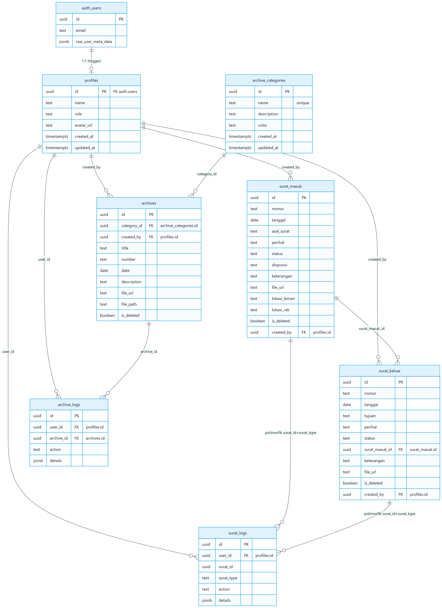

# 3. Skema Basis Data (Supabase / PostgreSQL)

Skema dibagi menjadi 3 file migration (dieksekusi berurutan):

| Migration | Isi |
| --- | --- |
| `src/migrations/001-auth-profiles.sql` | Tabel `profiles`, fungsi & trigger sinkronisasi dari `auth.users` |
| `src/migrations/002-archives.sql` | `archive_categories`, `archives`, `archive_logs`, trigger `handle_updated_at`, RLS, indeks |
| `src/migrations/003-surat.sql` | `surat_masuk`, `surat_keluar`, `surat_logs`, trigger `updated_at`, RLS, indeks |

## 3.1 Diagram ERD (hasil render)



> Keterangan relasi penting: `surat_logs` **tidak memiliki** foreign key ke `surat_masuk`/`surat_keluar`. Relasinya **polimorfik** via pasangan kolom `surat_id` (UUID) + `surat_type` (`'masuk'` | `'keluar'`) — sesuai definisi migration dan pemakaian `addLog` di kode.

## 3.2 Tabel `profiles`

Profil akun, di-sync otomatis dari `auth.users` lewat trigger. **Tidak memiliki kolom email** (email ada di `auth.users`).

| Kolom | Tipe | Keterangan |
| --- | --- | --- |
| `id` | `uuid` PK, FK `auth.users.id ON DELETE CASCADE` | Diisi otomatis dari `auth.users.id` |
| `name` | `text` | Nama (dari `raw_user_meta_data->>'name'`) |
| `role` | `text` | `'admin'` atau `'pimpinan'` |
| `avatar_url` | `text` | URL foto profil |
| `created_at` | `timestamptz` | Default `now()` |
| `updated_at` | `timestamptz` | Default `now()` |

Fungsi & trigger:

| Nama | Jenis | Perilaku |
| --- | --- | --- |
| `handle_new_user()` | fungsi | INSERT `profiles` dari `raw_user_meta_data` (name/role/avatar_url) |
| trigger `on_auth_user_created` | AFTER INSERT `auth.users` | Memanggil `handle_new_user()` |
| `handle_delete_user()` | fungsi | DELETE `profiles` milik `old.id` |
| trigger `on_auth_user_delated` *(nama sesuai kode)* | AFTER DELETE `auth.users` | Memanggil `handle_delete_user()` |

> Konsekuensi: setiap pengguna `auth.users` baru otomatis mendapat baris `profiles` (dibuat lewat UI modul Pengguna, seed, atau dashboard Supabase).

## 3.3 Tabel `archive_categories`

| Kolom | Tipe | Keterangan |
| --- | --- | --- |
| `id` | `uuid` PK | `gen_random_uuid()` |
| `name` | `text` NOT NULL, **unique** | Nama kategori |
| `description` | `text` | Deskripsi |
| `color` | `text` | Warna (hex), dipakai label & chart |
| `created_at` | `timestamptz` | Default `now()` |
| `updated_at` | `timestamptz` | Trigger `handle_updated_at` |

Dua kategori sistem dibuat otomatis oleh kearsipan:

| Kategori | Warna | Asal |
| --- | --- | --- |
| Surat Masuk | `#0ea5e9` | Arsip otomatis dari surat masuk |
| Surat Keluar | `#f97316` | Arsip otomatis dari surat keluar |

## 3.4 Tabel `archives`

Arsip digital + lokasi fisik. SELECT RLS hanya menampilkan `is_deleted = false` (arsip aktif).

| Kolom | Tipe | Keterangan |
| --- | --- | --- |
| `id` | `uuid` PK | |
| `category_id` | `uuid` FK `archive_categories(id) ON DELETE SET NULL` | Kategori arsip |
| `created_by` | `uuid` FK `profiles(id) ON DELETE SET NULL` | Pembuat arsip |
| `title` | `text` NOT NULL | Judul arsip |
| `number` | `text` | Nomor arsip (untuk arsip otomatis = nomor surat) |
| `date` | `date` | Tanggal |
| `description` | `text` | Deskripsi |
| `file_url` | `text` | URL publik berkas |
| `file_path` | `text` | Path di bucket (untuk hapus dari storage) |
| `file_name` | `text` | Nama file asli |
| `file_size` | `bigint` | Ukuran file (byte) |
| `is_deleted` / `deleted_at` | `boolean` default `false` / `timestamptz` | Soft delete |
| `created_at` / `updated_at` | `timestamptz` | Timestamp |

## 3.5 Tabel `surat_masuk`

| Kolom | Tipe | Keterangan |
| --- | --- | --- |
| `id` | `uuid` PK | |
| `nomor` | `text` NOT NULL | Nomor surat |
| `tanggal` | `date` | Tanggal surat |
| `asal_surat` | `text` | Asal surat |
| `perihal` | `text` NOT NULL | Perihal |
| `status` | `text` NOT NULL default `'diterima'` | Lihat nilai status |
| `disposisi` | `text` | Instruksi disposisi (dari `DISPOSISI_OPTIONS`) |
| `keterangan` | `text` | Keterangan |
| `file_url`/`file_path`/`file_name`/`file_size` | text/text/text/bigint | Berkas lampiran digital |
| `lokasi_lemari`/`lokasi_rak`/`lokasi_map`/`lokasi_box` | `text` | Lokasi fisik arsip |
| `keterangan_fisik` | `text` | Catatan arsip fisik |
| `created_by` | `uuid` FK `profiles(id) ON DELETE SET NULL` | Pembuat |
| `is_deleted`/`deleted_at` | boolean/timestamptz | Soft delete |
| `created_at`/`updated_at` | timestamptz | Timestamp |

Nilai `status` surat masuk (dari `src/constant/surat-constant.ts`):

| Nilai | Label | Urutan alur |
| --- | --- | --- |
| `diterima` | Diterima | awal |
| `disposisi` | Disposisi | lanjutan |
| `diproses` | Diproses | lanjutan |
| `selesai` | Selesai | lanjutan |
| `diarsipkan` | Diarsipkan | akhir (memicu kearsipan otomatis) |

## 3.6 Tabel `surat_keluar`

| Kolom | Tipe | Keterangan |
| --- | --- | --- |
| `id` | `uuid` PK | |
| `nomor` | `text` NOT NULL | Nomor surat |
| `tanggal` | `date` | Tanggal surat |
| `tujuan` | `text` | Tujuan / instansi penerima |
| `perihal` | `text` NOT NULL | Perihal |
| `status` | `text` NOT NULL default `'dibuat'` | Lihat nilai status |
| `surat_masuk_id` | `uuid` FK `surat_masuk(id) ON DELETE SET NULL` | Kaitkan ke surat masuk |
| `keterangan` | `text` | Keterangan |
| `file_*` / `lokasi_*` / `keterangan_fisik` | seperti surat_masuk | Berkas & lokasi fisik |
| `created_by`, `is_deleted`, `deleted_at`, `created_at`, `updated_at` | — | Sama seperti surat_masuk |

Nilai `status` surat keluar:

| Nilai | Label | Keterangan transisi |
| --- | --- | --- |
| `dibuat` | Dibuat | awal (default) |
| `disetujui` | Disetujui | **hanya** via `approveSuratKeluar` (guard: role `pimpinan` + status `dibuat`) |
| `dikirim` | Dikirim | transisi manual |
| `selesai` | Selesai | transisi manual |
| `diarsipkan` | Diarsipkan | akhir (memicu kearsipan otomatis) |

## 3.7 Tabel `surat_logs`

| Kolom | Tipe | Keterangan |
| --- | --- | --- |
| `id` | `uuid` PK | |
| `user_id` | `uuid` FK `profiles(id) ON DELETE SET NULL` | Pelaku aksi |
| `surat_id` | `uuid` NOT NULL | ID surat (masuk ATAU keluar) |
| `surat_type` | `text` NOT NULL | `'masuk'` atau `'keluar'` |
| `action` | `text` NOT NULL | Aksi log |
| `details` | `jsonb` | Data tambahan (contoh `{ role }` pada approve) |
| `created_at` | `timestamptz` | Waktu |

Nilai `action` yang dipakai kode:

| `action` | Dipakai saat |
| --- | --- |
| `create` | Surat dibuat |
| `update` | Surat diubah |
| `delete` | Surat di-soft-delete |
| `restore` | Surat dipulihkan dari sampah |
| `approve` | Surat keluar disetujui pimpinan (`details` berisi `role`) |

## 3.8 Tabel `archive_logs`

| Kolom | Tipe | Keterangan |
| --- | --- | --- |
| `id` | `uuid` PK | |
| `user_id` | `uuid` FK `profiles(id) ON DELETE SET NULL` | Pelaku |
| `archive_id` | `uuid` FK `archives(id) ON DELETE CASCADE` | Arsip terkait |
| `action` | `text` NOT NULL | Aksi log |
| `details` | `jsonb` | Data tambahan |
| `created_at` | `timestamptz` | Waktu |

Nilai `action` dan label UI:

| `action` | Label UI | Note |
| --- | --- | --- |
| `create` | Dibuat | Termasuk arsip manual |
| `update` | Diperbarui | |
| `delete` | Dihapus | Soft delete |
| `restore` | Dipulihkan | |
| `auto_archive` | — | Dipakai dedup kearsipan otomatis; `details` berisi `{ surat_id, surat_type }` |

## 3.9 Kearsipan Otomatis (relasi antar-tabel)

Ketika `createSuratMasuk` / `createSuratKeluar` / update membuat status menjadi **`diarsipkan`**, server action memanggil `archiveSuratRecord`:

1. **Cek duplikat**: query `archive_logs` (`action = 'auto_archive'` AND `details->>'surat_id'` = id surat AND `details->>'surat_type'` = jenis). Jika ada → **UPDATE** `archives` (sinkronkan judul/tanggal/deskripsi) → selesai.
2. **Buat baru**: `getOrCreateCategory` (Surat Masuk / Surat Keluar) → INSERT `archives` (`title = "{nomor} — {perihal}"`, `created_by`, dst.) → 2 baris `archive_logs` (`create` + `auto_archive`).

Poin penting desain DB:

| Aspek | Fakta |
| --- | --- |
| Soft delete | `is_deleted=true` + `deleted_at=now()`; RLS SELECT menyembunyikan baris terhapus |
| Restore | Set `is_deleted=false` + log `restore` |
| File | `file_path` disimpan agar bisa dihapus dari storage saat soft delete |

## 3.10 RLS (Row Level Security)

Semua tabel `public` mengaktifkan RLS dengan policy `to authenticated`, tanpa pembatasan role di database — setiap pengguna terautentikasi dapat SELECT/INSERT/UPDATE/DELETE (kecuali penyembunyian soft-delete di SELECT). Otorisasi berbasis role justru dilakukan di lapisan aplikasi (proxy guard + UI + `approveSuratKeluar`).

| Tabel | SELECT | INSERT | UPDATE | DELETE |
| --- | --- | --- | --- | --- |
| `profiles` | (tidak ada policy eksplisit di `001` — default deny) | — | — | — |
| `archive_categories` | true | true | true | true |
| `archives` | `is_deleted = false` | true | true | true |
| `archive_logs` | true | true | — | — |
| `surat_masuk` | `is_deleted = false` | true | true | true |
| `surat_keluar` | `is_deleted = false` | true | true | true |
| `surat_logs` | true | true | — | — |

> Catatan: `profiles` di `001-auth-profiles.sql` tidak mendefinisikan policy. Query SELECT `profiles` tetap bekerja via sesi pengguna yang RLS-enabled; untuk proyek produksi, tambahkan policy `profiles` bila diperlukan.

## 3.11 Indeks

| Tabel | Indeks |
| --- | --- |
| `archives` | category_id, created_by, is_deleted, date |
| `archive_logs` | archive_id, user_id |
| `surat_masuk` | nomor, status, is_deleted, tanggal, created_by |
| `surat_keluar` | nomor, status, is_deleted, tanggal, surat_masuk_id, created_by |
| `surat_logs` | surat_id, surat_type, user_id |

## 3.12 Cara Menerapkan Schema

Jalankan SQL migration berurutan di Supabase (SQL Editor):

```bash
# urutan:
# 1. src/migrations/001-auth-profiles.sql
# 2. src/migrations/002-archives.sql
# 3. src/migrations/003-surat.sql
```

Lalu siapkan storage & akun (langkah lengkap di [dok-04-cara-menjalankan.md](./dok-04-cara-menjalankan.md)).