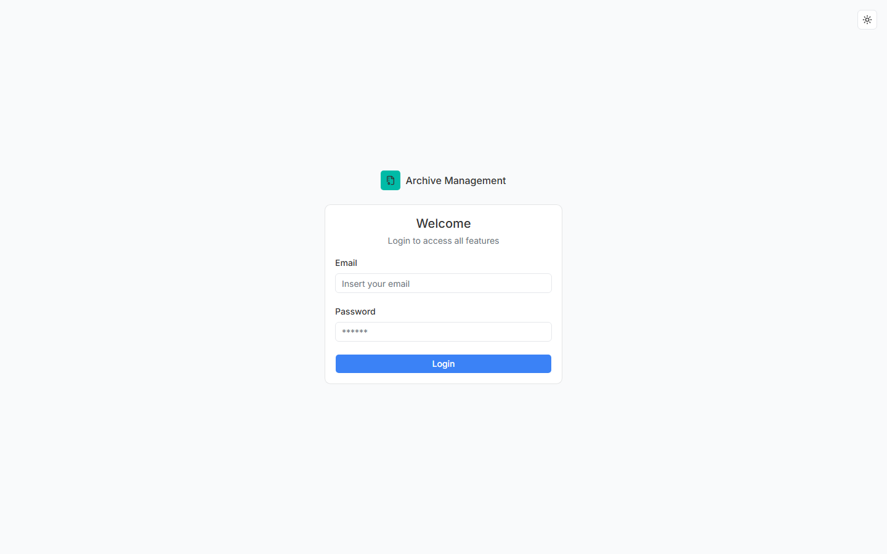

# 5. Panduan Penggunaan Aplikasi

Panduan lengkap cara memakai aplikasi, disusun **berurutan sesuai alur kerja nyata** (User Guide). Semua langkah mengikuti apa yang benar-benar tampil di UI.

## 5.1 Login

1. Buka aplikasi — ketika belum login, Anda otomatis diarahkan ke halaman **/login**.
2. Isi **Email** dan **Password**.
3. Klik tombol **Login**.

**Setelah login berhasil:**

- Cookie sesi aplikasi (`user_profile`) disimpan aman (httpOnly, berlaku 1 tahun).
- Anda diarahkan ke halaman utama (`/`), kemudian ke **Dashboard admin**.
- Menu sidebar menyesuaikan **peran Anda** (Admin atau Pimpinan).

**Jika login gagal**, muncul pemberitahuan (toast) *"Login Failed"* dengan keterangan, misalnya kredensial salah:

| Kemungkinan | Penyebab | Solusi |
| --- | --- | --- |
| Toast *Login Failed - Invalid login credentials* | Email/password salah | Periksa kembali; hubungi admin bila lupa |
| Form tetap menampilkan error | Validasi (email tidak valid, kosong) | Perbaiki isian |

> Karena nama user/password/akun hanya dikelola admin, tidak ada registrasi mandiri maupun *reset password* di aplikasi ini. Hubungi administrator bila perlu akun baru.

## 5.2 Dashboard

Dashboard tampil setelah login. Isinya **berbeda per role** (kode di `src/app/(dashboard)/admin/page.tsx`).

### Dashboard Admin (Petugas / Sekretaris)

| Blok | Isi |
| --- | --- |
| StatCard | 4 kartu: **Surat Masuk**, **Surat Keluar**, **Total Arsip** (+ *X baru bulan ini*), **User** |
| Surat Terbaru | 2 panel: 5 surat masuk & 5 surat keluar terbaru |
| Arsip Terbaru | Tabel 5 arsip: Nama Arsip, Kategori, Pengunggah, Tanggal, Aksi |
| Aktivitas Terbaru | 10 aktivitas terakhir (dari log arsip): Dibuat / Diperbarui / Dihapus / Dipulihkan |
| Arsip per Kategori | Grafik distribusi arsip per kategori |
| Ringkasan | Surat Masuk, Surat Keluar, Total Arsip, Upload Bulan Ini, Kategori, User Terdaftar |

### Dashboard Pimpinan

| Blok | Isi |
| --- | --- |
| Kotak pencarian | Kotak *"Cari nama dokumen atau kategori..."* → menuju halaman Arsip. Bila ditekan `Enter` |
| StatCard | 3 kartu: **Surat Masuk**, **Surat Keluar**, **Total Arsip** |
| Arsip Terbaru | Tabel: Nama Dokumen, Kategori, Tanggal, Aksi (lihat/unduh) |
| **Menunggu Persetujuan** | Daftar surat keluar berstatus *Dibuat* (maks. 5) — tugas utama pimpinan |
| Surat Terbaru | 2 panel surat masuk & keluar terbaru |

> Menu sidebar pimpinan hanya: **Surat Masuk**, **Surat Keluar**, **Arsip**. Tidak ada menu Dashboard, User, maupun Kategori. (URL Dashboard bisa tetap dibuka manual, namun bukan menu resmi.)

## 5.3 Manajemen Surat Masuk

Buka menu **Surat Masuk**. Halaman berisi judul **Surat Masuk**, tombol `+ Surat Masuk Baru`, tab **Semua / Aktif / Sampah**, kolom pencarian, dan filter status.

### Melihat & Mencari

1. Gunakan kotak **"Cari nomor, perihal, atau asal surat..."** untuk mencari.
2. Gunakan dropdown **Semua Status** untuk filter status.
3. Tab **Semua / Aktif / Sampah** untuk memilih cakupan.

Tabel menampilkan kolom: No, Nomor, Asal, Perihal, Tanggal, Status (dengan label berwarna), Aksi (menu ⋯).

### Melihat Detail

1. Klik ikon menu **⋯** pada baris → pilih **Detail**.
2. Dialog menampilkan data lengkap termasuk lampiran & log perubahan.

### Menambah (hanya admin)

1. Klik **`+ Surat Masuk Baru`**.
2. Isi formulir: **Nomor**, **Asal Surat**, **Perihal**, **Tanggal**, **Status**, **Disposisi** (opsi preset), **Keterangan**, plus lampiran **file** dan lokasi fisik arsip (opsional).
3. Klik tombol **Simpan**.
4. Berhasil → muncul notifikasi (toast) dan daftar diperbarui.

> Lampiran diunggah ke storage bucket `images` sub-folder `surat-masuk`.

### Mengubah (admin & pimpinan)

1. Klik menu **⋯** → **Edit** (ikon pensil).
2. Ubah isi formulir (termasuk **Disposisi** dan **Status**).
3. Simpan. Riwayat perubahan dicatat di log (`update`).

> Saat status diubah menjadi **Diarsipkan**, surat otomatis masuk ke **Arsip** (lihat [dok-06-fitur-file-arsip.md](./dok-06-fitur-file-arsip.md)).

### Menghapus (hanya admin)

1. Klik menu **⋯** → **Hapus** (ikon tempat sampah, berwarna merah).
2. Konfirmasi pada dialog penghapusan.
3. Data pindah ke tab **Sampah** (*soft delete*) — **tidak** terhapus permanen; file lampiran ikut dihapus dari storage.

## 5.4 Manajemen Surat Keluar

Buka menu **Surat Keluar** (judul **Surat Keluar**, tombol `+ Surat Keluar Baru`, tab & filter sama).

- **Admin**: bisa menambah, mengubah, menghapus, melihat detail.
- **Pimpinan**: hanya melihat detail dan **menyetujui** surat yang berstatus *Dibuat*.

### Menyetujui Surat Keluar (khusus pimpinan) ⭐

1. Pastikan surat berstatus **Dibuat** (kotak biru).
2. Klik menu **⋯** pada baris → pilih **Setujui** (ikon centang badge).
   *(Menu Setujui hanya muncul untuk role pimpinan dan hanya jika status = Dibuat.)*
3. Status berubah menjadi **Disetujui** (kotak kuning) dan log tercatat (`approve`).
4. Bila bukan pimpinan menekan aksi ini, server **menolak** dengan pesan: *"Hanya pimpinan yang dapat menyetujui surat keluar."*

> Pengaman berlaku dua lapis: menu hanya tampil di role pimpinan, dan server action `approveSuratKeluar` memeriksa role serta status.

### Membuat Surat Keluar (admin)

1. Klik **`+ Surat Keluar Baru`**.
2. Isi **Nomor**, **Tujuan**, **Perihal**, **Tanggal**, **Status**, **Keterangan**, lampiran file, serta **Surat Masuk terkait** (opsional) dan lokasi fisik.
3. Simpan. Bila status langsung *Diarsipkan*, arsip otomatis dibuat.

## 5.5 Manajemen Arsip Digital

Buka menu **Arsip → Semua Arsip** (halaman **Manajemen Arsip**, tombol `+ Arsip Baru`).

- Berlaku untuk **admin dan pimpinan** (tidak ada pembatasan role di halaman ini).
- Pencarian: **"Cari judul atau nomor dokumen..."**
- Filter: **Semua Kategori**.

Tabel: No, Nomor, Judul, Kategori, Tanggal, Aksi (menu ⋯ → **Detail / Edit / Hapus**; tab Sampah → **Pulihkan**).

> Setiap arsip menyimpan `file_url`/`file_path`; file dibuka lewat **Detail**.

## 5.6 Manajemen Kategori Arsip (admin)

Menu **Arsip → Kategori** (halaman **Kategori**). Admin dapat:
- **Tambah** kategori (Nama, Deskripsi, Warna).
- **Ubah** kategori.
- **Hapus** kategori (*hard delete* — dihapus permanen).

> Pimpinan yang membuka `/admin/archive/category` **diblokir** oleh proxy (redirect ke `/admin`).

## 5.7 Manajemen Pengguna (admin)

Menu **User** (admin). Kemampuan:
- **Tambah pengguna**: email, password, nama, role (Admin/Pimpinan), avatar.
- **Ubah pengguna**: nama, role, avatar.
- **Hapus pengguna**: konfirmasi, lalu akun + profil dihapus (avatar ikut dihapus dari storage).

> Modul memakai **service role** untuk membuat/menghapus akun sehingga tetap bekerja walau RLS deny. Pimpinan diblokir membuka halaman ini.

## 5.8 Sampah & Pemulihan (semua role)

1. Buka tab **Sampah** pada halaman Surat Masuk / Surat Keluar / Arsip.
2. Klik menu **⋯** → **Pulihkan**.
3. Baris kembali aktif (status log `restore`).

> Hapus = *soft delete*: baris disembunyikan dari list aktif, data & log tetap tersimpan, dan bisa dipulihkan kapan saja.

## 5.9 User Guide Berurutan (Skenario Nyata)

### Skenario A — Mencatat surat masuk baru (petugas)

1. Login → Dashboard admin.
2. Menu **Surat Masuk** → **`+ Surat Masuk Baru`**.
3. Isi nomor/perihal/asal, lampirkan scan file (opsional), atur status **Diterima**.
4. **Simpan** → toast sukses.
5. Ketika surat selesai diproses, ubah lewat **Edit** ke status **Selesai**.
6. Setelah berakhir masa aktif, ubah status ke **Diarsipkan** → arsip digital otomatis terbentuk.

### Skenario B — Persetujuan surat keluar (pimpinan)

1. Login → Dashboard pimpinan → lihat blok **Menunggu Persetujuan**.
2. Buka menu **Surat Keluar** → cari baris status *Dibuat*.
3. Klik **⋯ → Setujui** → status *Disetujui*.
4. (Lanjutan) admin mengubah status menjadi *Dikirim → Selesai → Diarsipkan*.

### Skenario C — Cari & unduh arsip

1. Menu **Arsip → Semua Arsip**.
2. Ketik kata kunci di kotak pencarian (judul/nomor) atau pilih kategori.
3. Klik **⋯ → Detail** untuk melihat; buka/unduh file lampiran.

### Skenario D — Perbaiki data salah & pulihkan data terhapus

1. Klik **⋯ → Edit**, perbaiki, simpan.
2. Bila pernah terhapus: tab **Sampah** → **Pulihkan**.

### Skenario E — Logout

1. Klik foto/ikon profil di **sidebar** → pilih **Keluar** (sign out).

## 5.10 Ringkasan Tombol & Label UI

| Lokasi | Label | Tampil untuk | Fungsi |
| --- | --- | --- | --- |
| Surat Masuk | `+ Surat Masuk Baru` | Admin | Buka form tambah |
| Surat Keluar | `+ Surat Keluar Baru` | Admin | Buka form tambah |
| Arsip | `+ Arsip Baru` | Admin & Pimpinan | Buka form tambah arsip |
| Menu baris | **Detail** | Semua | Lihat detail & log |
| Menu baris | **Edit** | Surat Masuk: semua; Surat Keluar & Arsip: semua | Ubah data |
| Menu baris | **Hapus** | Admin (Surat); semua (Arsip) | Soft delete |
| Menu baris (Sampah) | **Pulihkan** | Semua | Restore baris |
| Menu baris | **Setujui** | Pimpinan, status *Dibuat* | Approve surat keluar |