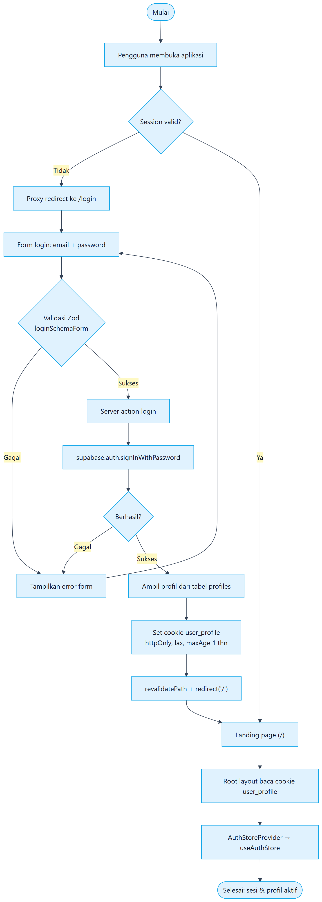
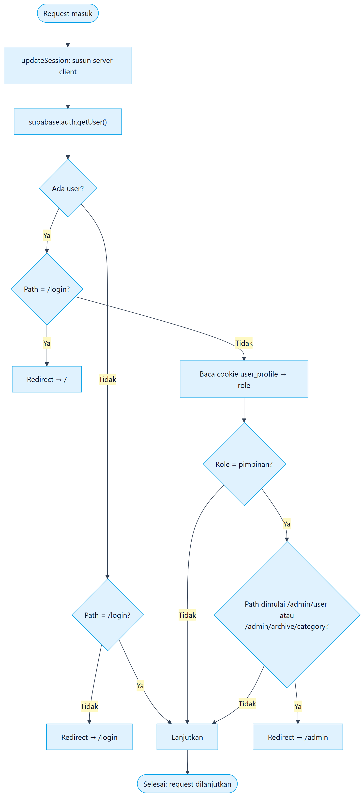
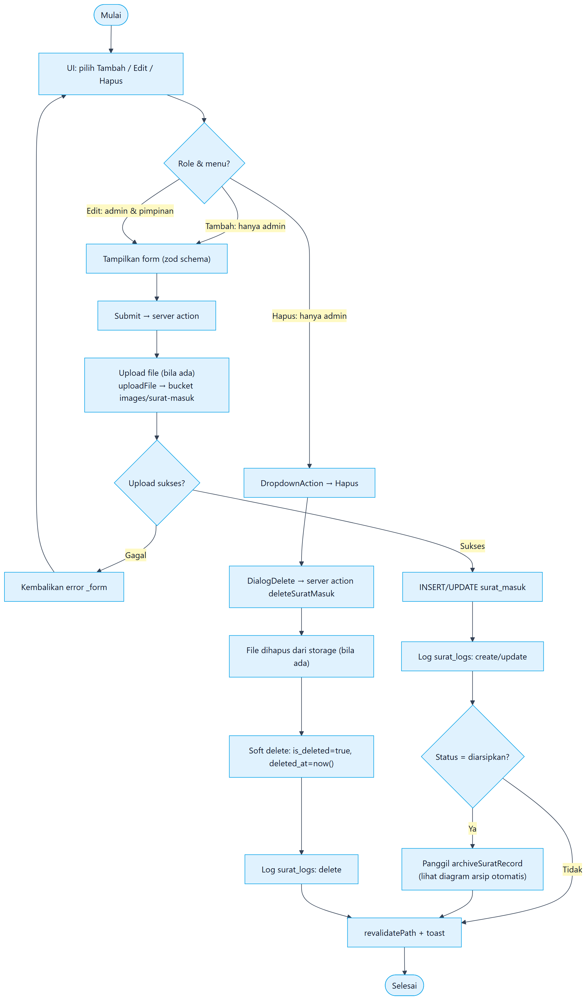
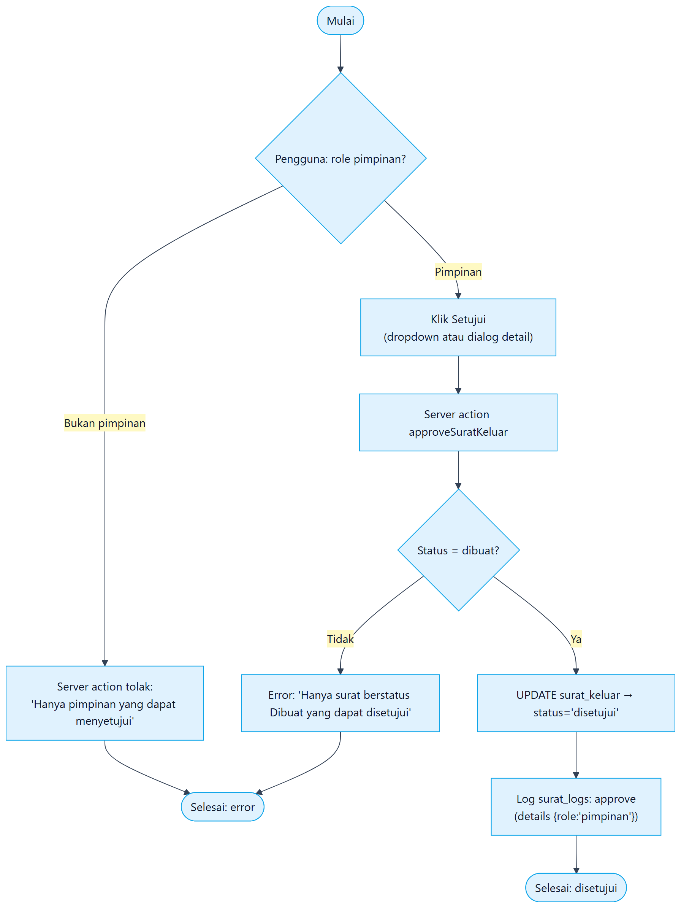
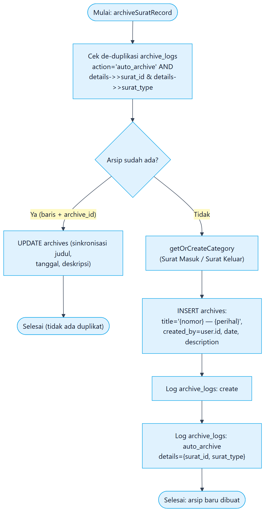
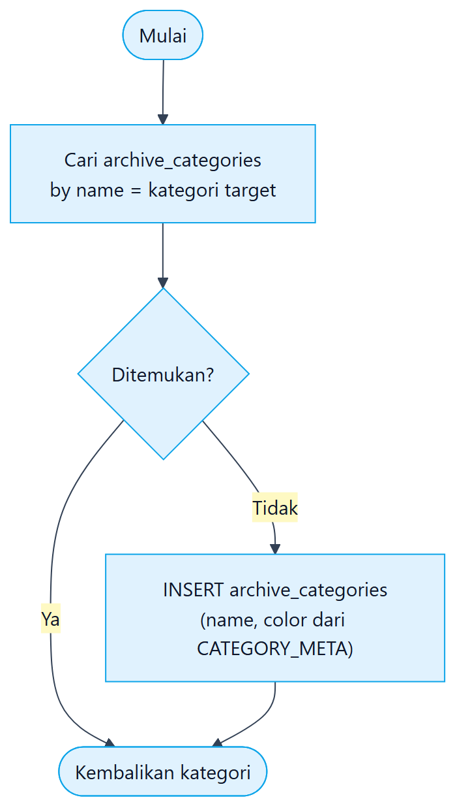
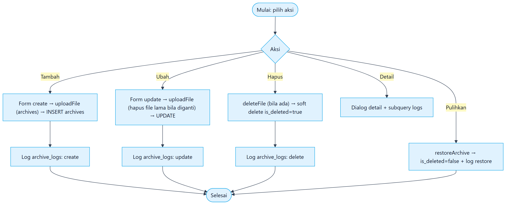
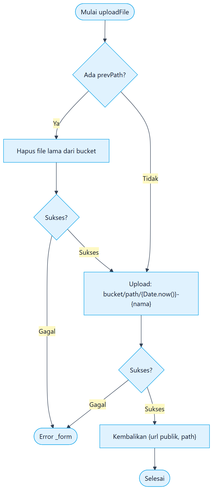
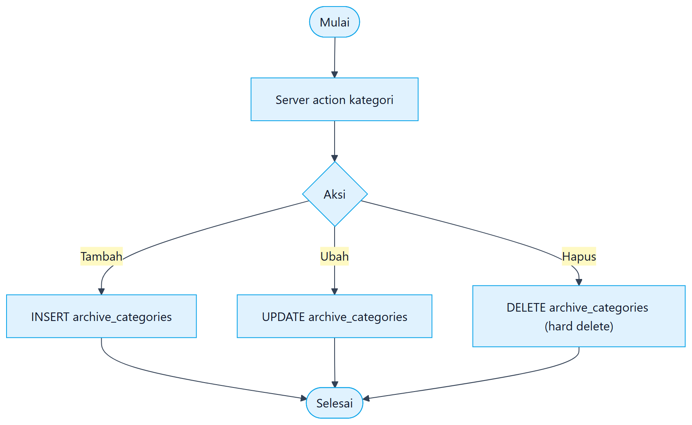
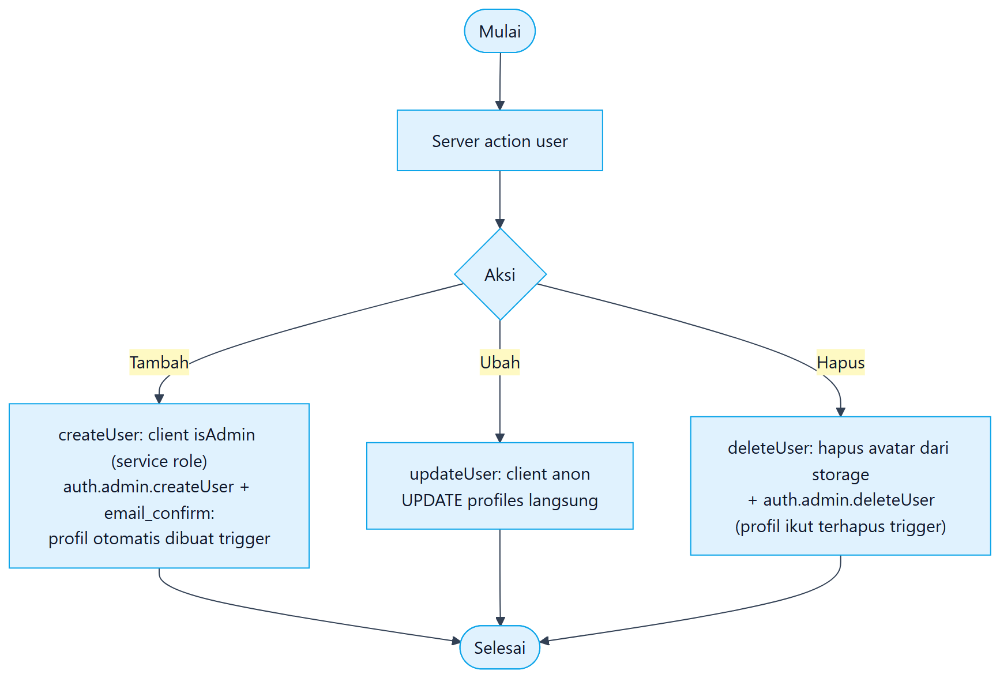

# 7. Workflow Aplikasi & Alur Sistem

Dua bagian: **(A) Workflow dalam bahasa sederhana** untuk semua pembaca, dan **(B) System Flow** (10 diagram hasil render) untuk pengembang.

## Bagian A — Workflow dalam Bahasa Sederhana

### Alur 1: Surat Masuk

```text
Surat datang
   ↓
Petugas mencatat (nomor, asal, perihal, lampiran)
   ↓
Diikuti statusnya: Diterima → Disposisi → Diproses → Selesai
   ↓
Setelah selesai diproses, diubah ke status "Diarsipkan"
   ↓
Sistem otomatis membuat Arsip Digital (sekali saja)
```

### Alur 2: Surat Keluar

```text
Petugas mencatat surat keluar (status "Dibuat")
   ↓
Pimpinan menyetujui (tombol "Setujui") → status "Disetujui"
   ↓
Petugas melengkapi: Dikirim → Selesai
   ↓
Diubah ke status "Diarsipkan" → Arsip Digital (sekali saja)
```

### Alur 3: Sampah & Pulihkan

```text
Hapus (soft delete)  ──►  pindah ke tab "Sampah"
   │
   └────────►  "Pulihkan"  ──►  kembali ke daftar aktif
```

### Alur 4: Login & Keamanan

```text
Buka aplikasi → belum login? → dialihkan ke /login
Login benar → cookie sesi → Dashboard sesuai role
Pimpinan buka User/Kategori → diblokir → kembali ke /admin
```

## Bagian B — System Flow (10 diagram)

> Notasi: stadium = mulai/selesai, kotak = proses, belah ketupat = keputusan.

### 1. Alur Login & Setup Sesi



### 2. Guard Akses (Proxy `src/proxy.ts`)



### 3. Surat Masuk — Buat / Ubah / Hapus



### 4. Surat Keluar — Persetujuan Pimpinan

Transisi `dibuat → disetujui` **hanya** lewat `approveSuratKeluar`.



### 5. Kearsipan Otomatis (`src/lib/surat-archive.ts`)



Detil `getOrCreateCategory`:



### 6. Arsip Digital — CRUD & Restore (semua role)

> Tidak ada guard role di UI arsip; admin & pimpinan sama-sama dapat menambah/mengubah/hapus/memulihkan. Guard hanya di proxy untuk halaman Kategori.



### 7. Upload & Hapus Berkas (Storage)



### 8. Manajemen Kategori Arsip (hanya admin — pimpinan diblokir proxy)



### 9. Manajemen Pengguna (hanya admin — pimpinan diblokir proxy)



---

### Ambang batas yang tidak ada

| Alur | Tidak ada di aplikasi |
| --- | --- |
| Registrasi / lupa password | Tidak ada |
| Notifikasi email | Tidak ada |
| Admin menyetujui surat keluar | Tidak bisa (guard server) |
| Disposisi kompleks multi-unit | Disposisi adalah teks pilihan preset pada surat masuk |