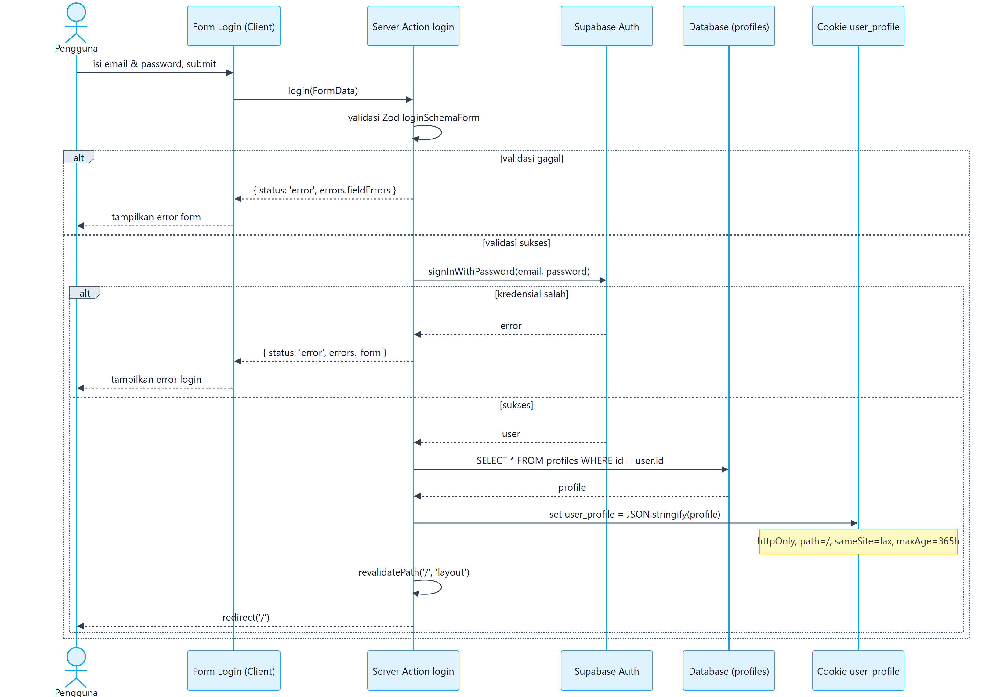
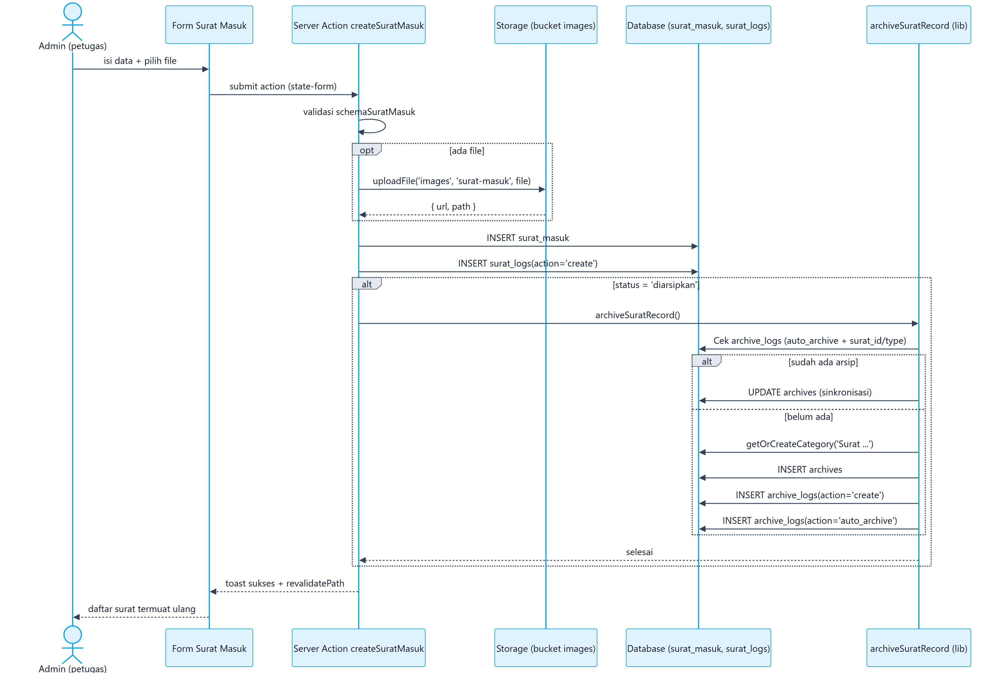
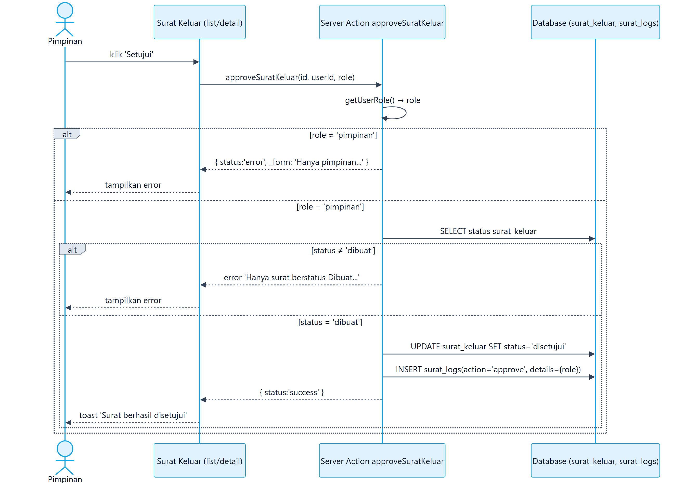
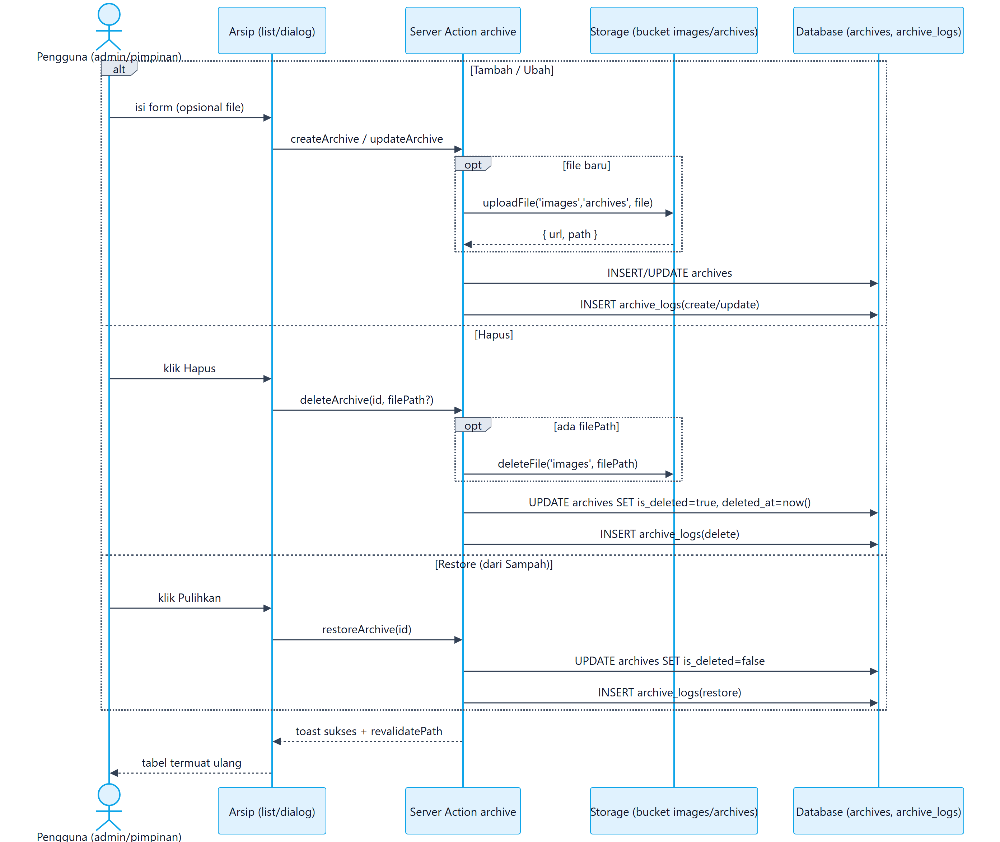
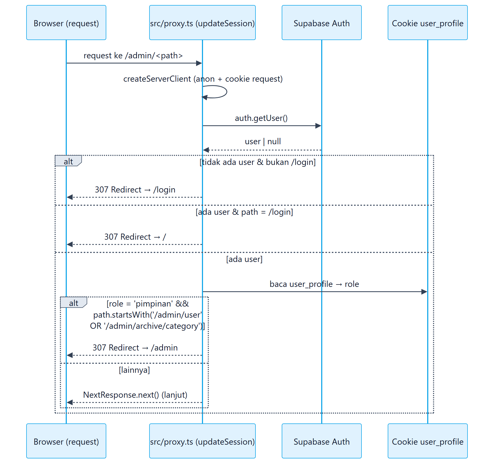

# 9. Sequence Diagram

Sequence diagram memakai notasi participant/lifeline dengan blok `alt`/`opt` untuk percabangan. Semua diagram adalah **hasil render** (PNG).

## 9.1 Login

## 9.2 Tambah Surat Masuk + Kearsipan Otomatis

> Alur identik untuk `createSuratKeluar` (bucket `surat-keluar`, tabel `surat_keluar`, kategori 'Surat Keluar').

## 9.3 Persetujuan Surat Keluar

## 9.4 CRUD & Restore Arsip (semua role)

## 9.5 Guard Akses Proxy

