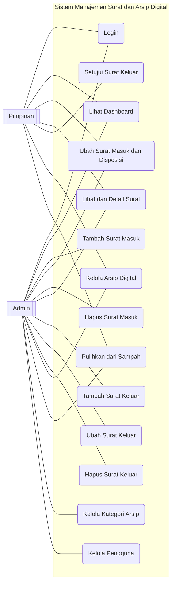
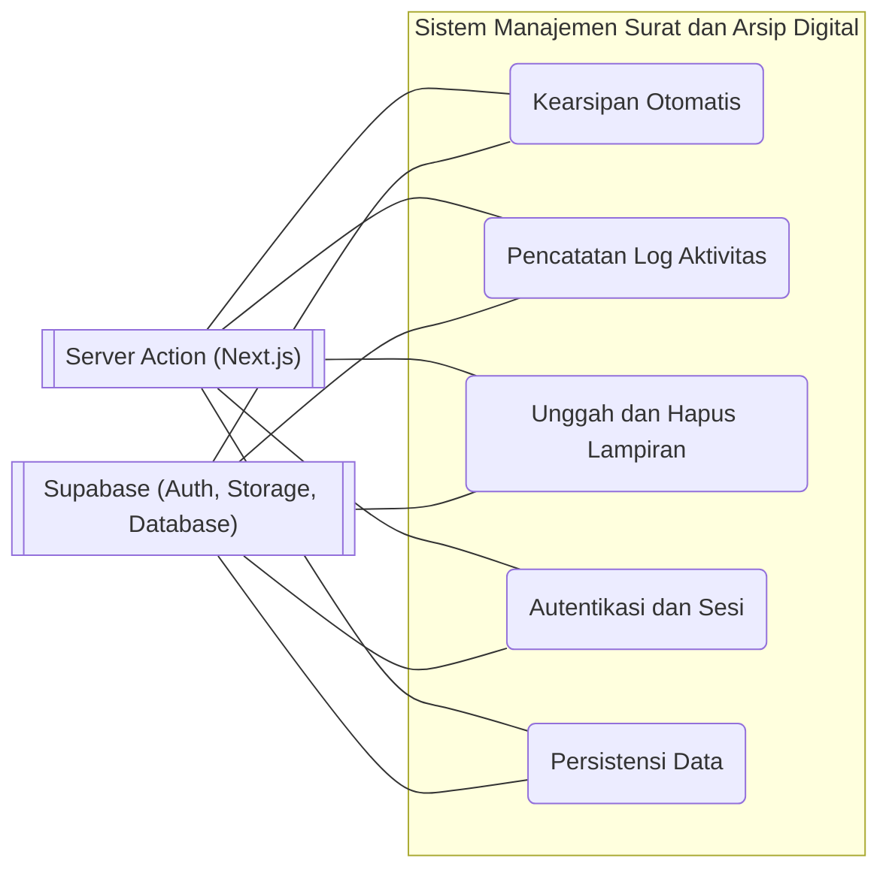

# 10. Use Case Diagram

Notasi (Mermaid `flowchart`): **aktor** `[[...]]` di luar batas sistem, **use case** elips `(...)` di dalam kotak sistem, **asosiasi** = garis `---` (hubungan tak berarah antar aktor dan use case). Tidak ada `<<include>>`/`<<extend>>` yang dipakai — semua perilaku aktual dinyatakan sebagai use case mandiri; kearsipan otomatis adalah proses sistem sederhana yang dijalankan server saat status surat menjadi `diarsipkan` (diperlihatkan pada 10.2, alurnya di [dok-08](./dok-08-activity-diagram.md)).

## 10.1 Diagram Use Case Utama (aktor Admin & Pimpinan)

Pemetaan aktor yang sebenarnya:

| Fitur | Admin (`role: admin`) | Pimpinan (`role: pimpinan`) |
| --- | --- | --- |
| Login | ✔ | ✔ |
| Lihat Dashboard | ✔ (lengkap: 4 kartu statistik, grafik, aktivitas) | ✔ (ringkas: pencarian, arsip terbaru, menunggu persetujuan) |
| Kelola Surat Masuk | Tambah, Ubah, Hapus, Detail | Ubah & Detail (tanpa tambah/hapus) |
| Kelola Surat Keluar | Tambah, Ubah, Hapus, Detail | Detail + Setujui |
| Kelola Arsip Digital | Tambah, Ubah, Hapus, Detail, Pulihkan | Sama penuh (tanpa guard role) |
| Kelola Kategori Arsip | ✔ (CRUD) | Diblokir proxy — redirect ke `/admin` |
| Kelola Pengguna | ✔ (CRUD akun) | Diblokir proxy — redirect ke `/admin` |
| Pulihkan dari Sampah | ✔ | ✔ |

> Validasi: guard UI `isPimpinan` di `surat-masuk.tsx`/`surat-keluar.tsx` (tombol Tambah/Hapus disembunyikan untuk pimpinan; `Setujui` hanya muncul untuk pimpinan saat status `dibuat`), guard server `approveSuratKeluar`, dan guard proxy [`src/proxy.ts`](../src/proxy.ts) untuk `/admin/user` serta `/admin/archive/category`.

## 10.2 Diagram Use Case Sistem (Kearsipan Otomatis & Integrasi Eksternal)

| Use Case sistem | Aktor eksternal | Patokan kode |
| --- | --- | --- |
| Kearsipan Otomatis | Server Action (`archiveSuratRecord`) + Supabase | `src/lib/surat-archive.ts` |
| Pencatatan Log Aktivitas | Server Action + Supabase (`surat_logs`, `archive_logs`) | semua `addLog` di `*/actions.ts` |
| Unggah dan Hapus Lampiran | Server Action + Supabase Storage (bucket `images`) | `src/actions/storage-action.ts` |
| Autentikasi dan Sesi | Server Action + Supabase Auth + cookie `user_profile` | `src/app/(auth)/login/actions.ts`, `src/lib/supabase/*` |
| Persistensi Data | Server Action + Supabase Postgres (tabel + RLS) | `src/migrations/*.sql` |

## 10.3 Katalog Use Case

| Use Case | Aktor | Deskripsi | Patokan kode |
| --- | --- | --- | --- |
| **UC1 Login** | Admin, Pimpinan | Autentikasi email/password + cookie `user_profile` | `src/app/(auth)/login/actions.ts` |
| **UC2 Lihat Dashboard** | Admin, Pimpinan | Statistik ringkas; konten berbeda per role | `src/app/(dashboard)/admin/page.tsx` |
| **UC3 Tambah Surat Masuk** | Admin hanya | Form + upload + log `create` | `surat-masuk/actions.ts` |
| **UC4 Ubah Surat Masuk & Disposisi** | Admin, Pimpinan | Ubah data surat masuk (termasuk disposisi & status) | `surat-masuk/actions.ts` |
| **UC5 Hapus Surat Masuk** | Admin hanya | Soft delete + hapus file | `surat-masuk/actions.ts` |
| **UC6 Lihat & Detail Surat** | Admin, Pimpinan | Daftar, pencarian, dialog detail + log | `_components/dialog-detail-*` |
| **UC7 Tambah Surat Keluar** | Admin hanya | Form + upload + log `create` | `surat-keluar/actions.ts` |
| **UC8 Ubah Surat Keluar** | Admin hanya | Ubah data surat keluar | `surat-keluar/actions.ts` |
| **UC9 Hapus Surat Keluar** | Admin hanya | Soft delete + hapus file | `surat-keluar/actions.ts` |
| **UC10 Setujui Surat Keluar** | Pimpinan hanya | `dibuat` → `disetujui`; guard server role | `surat-keluar/actions.ts` (`approveSuratKeluar`) |
| **UC11 Kelola Arsip Digital** | Admin, Pimpinan | CRUD + detail (tanpa guard role di UI) | `archive/actions.ts` |
| **UC12 Pulihkan dari Sampah** | Admin, Pimpinan | Restore baris soft-deleted + log `restore` | semua action `restore*` |
| **UC13 Kelola Kategori Arsip** | Admin hanya | CRUD kategori (pimpinan diblokir proxy) | `archive/category/actions.ts` |
| **UC14 Kelola Pengguna** | Admin hanya | CRUD akun (service role untuk create/delete) | `user/actions.ts` |
| **UC15 Kearsipan Otomatis** | Sistem | Dijalankan server saat status surat = `diarsipkan` | `src/lib/surat-archive.ts` |

## 10.4 Yang Tidak Termasuk dalam Sistem

Dokumentasi hanya mencatat perilaku yang benar-benar ada. Tidak ada use case berikut:

| Hal | Alasan |
| --- | --- |
| Registrasi mandiri / reset password | Tidak ada halaman/action; akun dibuat via modul Pengguna |
| Notifikasi / email | Tidak ada mekanisme notifikasi |
| Approve surat keluar oleh admin | Guard server `approveSuratKeluar` menolak `role ≠ 'pimpinan'` |
| Route khusus pimpinan | Tidak ada `(dashboard)/pimpinan/*`; pimpinan memakai `/admin/*` |
| Disposisi sebagai entitas/alur | Disposisi adalah field teks `disposisi` dengan opsi preset |
| API REST manual | Seluruh mutasi lewat server actions |