# 11. Class Diagram

Class digambarkan langsung dengan **Mermaid `classDiagram`**, dibagi dua lapisan agar mudah dibaca:

- **Diagram A** — Lapisan UI (client components yang benar-benar ada).
- **Diagram B** — Lapisan Server (server actions + lib + klien Supabase).

Relasi: komposisi `*--` (komponen dimiliki halaman), asosiasi `-->`, dependensi `..>` (pemakaian modul/klien). Hanya satu entitas *domain* yang ikut digambar karena kode memakai **tipe/type + server action fungsional**, bukan class OOP. Nama class = nama modul/fungsi ekspor yang ada di codebase.

Konsistensi: class di bawah mendukung Use Case dan Activity Diagram di [dok-10](./dok-10-use-case-diagram.md) dan [dok-08](./dok-08-activity-diagram.md).

## 11.1 Diagram A — Lapisan UI

```mermaid
classDiagram
  class SuratMasukManagement {
    +activeTab: string
    +filterStatus: string
    +isPimpinan: boolean
    +refetch() void
  }
  class SuratKeluarManagement {
    +activeTab: string
    +isPimpinan: boolean
    +refetch() void
  }
  class ArchiveManagement {
    +refetch() void
  }
  class CategoryManagement {
    +refetch() void
  }
  class UserManagement {
    +refetch() void
  }
  class AdminDashboardPage {
    -role: string
    +archiveCount: number
    +pendingSuratKeluar: SuratKeluar[]
  }
  class DataTable
  class DialogCreateSuratMasuk
  class DialogUpdateSuratMasuk
  class DialogDeleteSuratMasuk
  class DialogDetailSuratMasuk
  class DialogCreateSuratKeluar
  class DialogUpdateSuratKeluar
  class DialogDeleteSuratKeluar
  class DialogDetailSuratKeluar
  class DialogCreateArchive
  class DialogUpdateArchive
  class DialogDeleteArchive
  class DialogDetailArchive
  class DialogCreateCategory
  class DialogUpdateCategory
  class DialogDeleteCategory
  class DialogCreateUser
  class DialogUpdateUser
  class DialogDeleteUser
  class StatCard
  class RecentSurat
  class RecentActivity
  class ArchiveChart
  class WelcomeSection
  class useAuthStore {
    +profile: Profile
  }
  class SupabaseBrowserClient {
    +createClient() BrowserClient
  }
  SuratMasukManagement *-- DialogCreateSuratMasuk
  SuratMasukManagement *-- DialogUpdateSuratMasuk
  SuratMasukManagement *-- DialogDeleteSuratMasuk
  SuratMasukManagement *-- DialogDetailSuratMasuk
  SuratMasukManagement --> DataTable
  SuratKeluarManagement *-- DialogCreateSuratKeluar
  SuratKeluarManagement *-- DialogUpdateSuratKeluar
  SuratKeluarManagement *-- DialogDeleteSuratKeluar
  SuratKeluarManagement *-- DialogDetailSuratKeluar
  SuratKeluarManagement --> DataTable
  ArchiveManagement *-- DialogCreateArchive
  ArchiveManagement *-- DialogUpdateArchive
  ArchiveManagement *-- DialogDeleteArchive
  ArchiveManagement *-- DialogDetailArchive
  ArchiveManagement --> DataTable
  CategoryManagement *-- DialogCreateCategory
  CategoryManagement *-- DialogUpdateCategory
  CategoryManagement *-- DialogDeleteCategory
  CategoryManagement --> DataTable
  UserManagement *-- DialogCreateUser
  UserManagement *-- DialogUpdateUser
  UserManagement *-- DialogDeleteUser
  UserManagement --> DataTable
  AdminDashboardPage --> StatCard
  AdminDashboardPage --> WelcomeSection
  AdminDashboardPage --> RecentSurat
  AdminDashboardPage --> RecentActivity
  AdminDashboardPage --> ArchiveChart
  SuratMasukManagement ..> useAuthStore : ambil role
  SuratKeluarManagement ..> useAuthStore : ambil role
  SuratMasukManagement ..> SupabaseBrowserClient : query data
  SuratKeluarManagement ..> SupabaseBrowserClient : query data
  ArchiveManagement ..> SupabaseBrowserClient : query data
  AdminDashboardPage ..> SupabaseBrowserClient : query data
```

## 11.2 Diagram B — Lapisan Server & Logika

```mermaid
classDiagram
  class SupabaseServerClient {
    +createClient(options) Client
  }
  class SessionGuard {
    +updateSession(request) Response
  }
  class SuratMasukActions {
    +createSuratMasuk(prevState, formData)
    +updateSuratMasuk(prevState, formData)
    +deleteSuratMasuk(prevState, formData)
    +restoreSuratMasuk(prevState, formData)
  }
  class SuratKeluarActions {
    +createSuratKeluar(prevState, formData)
    +updateSuratKeluar(prevState, formData)
    +deleteSuratKeluar(prevState, formData)
    +restoreSuratKeluar(prevState, formData)
    +approveSuratKeluar(prevState, formData)
    -getUserRole(supabase, userId)
  }
  class ArchiveActions {
    +createArchive(prevState, formData)
    +updateArchive(prevState, formData)
    +deleteArchive(prevState, formData)
    +restoreArchive(prevState, formData)
  }
  class CategoryActions {
    +createCategory(prevState, formData)
    +updateCategory(prevState, formData)
    +deleteCategory(prevState, formData)
  }
  class UserActions {
    +createUser(prevState, formData)
    +updateUser(prevState, formData)
    +deleteUser(prevState, formData)
  }
  class LoginActions {
    +login(prevState, formData)
  }
  class SignOutAction {
    +signOut() void
  }
  class StorageActions {
    +uploadFile(bucket, path, file, prevPath) data
    +deleteFile(bucket, path) status
  }
  class SuratArchiveService {
    -CATEGORY_META
    -getOrCreateCategory(supabase, suratType)
    +archiveSuratRecord(supabase, source)
  }
  class SuratMasuk
  class SuratKeluar
  class SuratLog
  class Archive
  class ArchiveCategory
  class ArchiveLog
  class Profile
  class CreateSuratMasukSchema
  class UpdateSuratMasukSchema
  class CreateSuratKeluarSchema
  class UpdateSuratKeluarSchema
  class CreateArchiveSchema
  class UpdateArchiveSchema
  class CreateCategorySchema
  class UpdateCategorySchema
  class LoginSchemaForm
  class CreateUserSchema
  class UpdateUserSchema
  SuratMasukActions ..> CreateSuratMasukSchema : validasi input
  SuratMasukActions ..> UpdateSuratMasukSchema : validasi input
  SuratMasukActions ..> SupabaseServerClient : createClient
  SuratMasukActions ..> StorageActions : unggah/hapus lampiran
  SuratMasukActions ..> SuratArchiveService : saat status diarsipkan
  SuratKeluarActions ..> CreateSuratKeluarSchema : validasi input
  SuratKeluarActions ..> UpdateSuratKeluarSchema : validasi input
  SuratKeluarActions ..> SupabaseServerClient : createClient
  SuratKeluarActions ..> StorageActions : unggah/hapus lampiran
  SuratKeluarActions ..> SuratArchiveService : saat status diarsipkan
  ArchiveActions ..> CreateArchiveSchema : validasi input
  ArchiveActions ..> UpdateArchiveSchema : validasi input
  ArchiveActions ..> SupabaseServerClient : createClient
  ArchiveActions ..> StorageActions : unggah/hapus lampiran
  CategoryActions ..> CreateCategorySchema : validasi input
  CategoryActions ..> UpdateCategorySchema : validasi input
  CategoryActions ..> SupabaseServerClient : createClient
  UserActions ..> CreateUserSchema : validasi input
  UserActions ..> UpdateUserSchema : validasi input
  UserActions ..> SupabaseServerClient : createClient isAdmin true
  UserActions ..> StorageActions : unggah avatar
  LoginActions ..> LoginSchemaForm : validasi input
  LoginActions ..> SupabaseServerClient : signInWithPassword
  LoginActions ..> Profile : cookie user_profile
  SignOutAction ..> SupabaseServerClient : auth.signOut
  SessionGuard ..> SupabaseServerClient : getUser
  SuratArchiveService ..> SupabaseServerClient : createClient
  ArchiveCategory "1" o-- "0..*" Archive : memiliki
  Archive "1" o-- "*" ArchiveLog : tercatat
  SuratLog ..> SuratMasuk : surat_id (polimorfik)
  SuratLog ..> SuratKeluar : surat_id (polimorfik)
```

## 11.3 Catatan Pembeda Penting (Akurasi)

| Topik | Fakta |
| --- | --- |
| `UserActions.createUser` | Memakai `createClient({ isAdmin: true })` (**service role**) — `auth.admin.createUser` + `email_confirm: true`, metadata `{ name, role, avatar_url }` |
| `UserActions.updateUser` | Memakai client normal (anon) → menulis langsung ke tabel `profiles` |
| `UserActions.deleteUser` | Service role (`auth.admin.deleteUser`) + hapus avatar |
| Guard server berbasis role | Hanya `approveSuratKeluar` (role `pimpinan` + status `dibuat`); action surat lainnya **tidak** cek role |
| `getUserRole(supabase, userId)` | Helper privat di `surat-keluar/actions.ts`; mengembalikan `role` dari `profiles` untuk menolak approve non-pimpinan |
| Guard lainnya | UI (`isPimpinan`) + proxy `src/proxy.ts` untuk `/admin/user` dan `/admin/archive/category` |
| Delete | `deleteSuratMasuk`/`deleteSuratKeluar`/`deleteArchive` = *soft delete* (`is_deleted=true`, `deleted_at=now()`) + hapus file storage bila `file_path` ada |
| Restore | `restore*` mengembalikan `is_deleted=false` + log `restore` |
| Kearsipan otomatis | `archiveSuratRecord` dedup via `archive_logs` (aksi `auto_archive`, `details->>surat_id` + `surat_type`); kategori otomatis bernama *Surat Masuk* / *Surat Keluar* |
| Auth calls | `signInWithPassword`/`getUser` memakai `SupabaseBrowserClient`/`SupabaseServerClient` — tidak ada class khusus metode auth |

## 11.4 Utilitas & Provider (lintas lapisan)

| Nama | File | Keterangan |
| --- | --- | --- |
| `useAuthStore` | `src/store/auth-store.ts` | State global profil (Zustand) |
| `AuthStoreProvider` | `src/providers/auth-store-provider.tsx` | Inject profil dari cookie ke store |
| `ReactQueryProvider` | `src/providers/react-query-provider.tsx` | QueryClient TanStack Query |
| `ThemeProvider` | `src/providers/theme-provider.tsx` | Dark/light mode |
| `useDataTable` | `src/hooks/use-data-table.tsx` | Pagination + search + limit |
| `useDebounce` | `src/hooks/use-debounce.tsx` | Debounce pencarian |
| `cn` | `src/lib/utils.ts` | Gabung class utility |